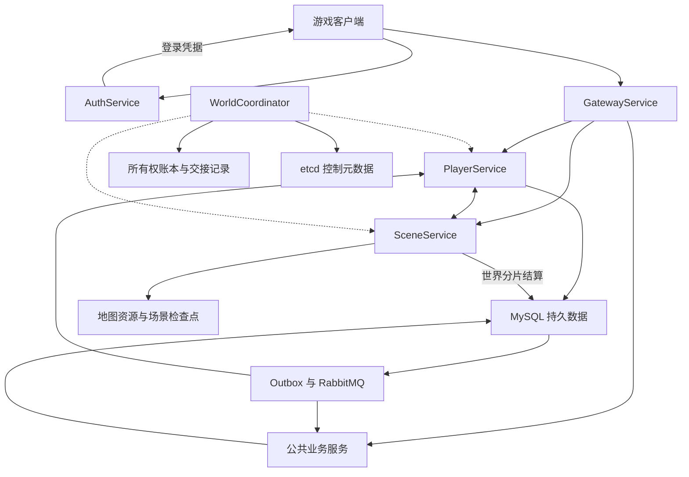
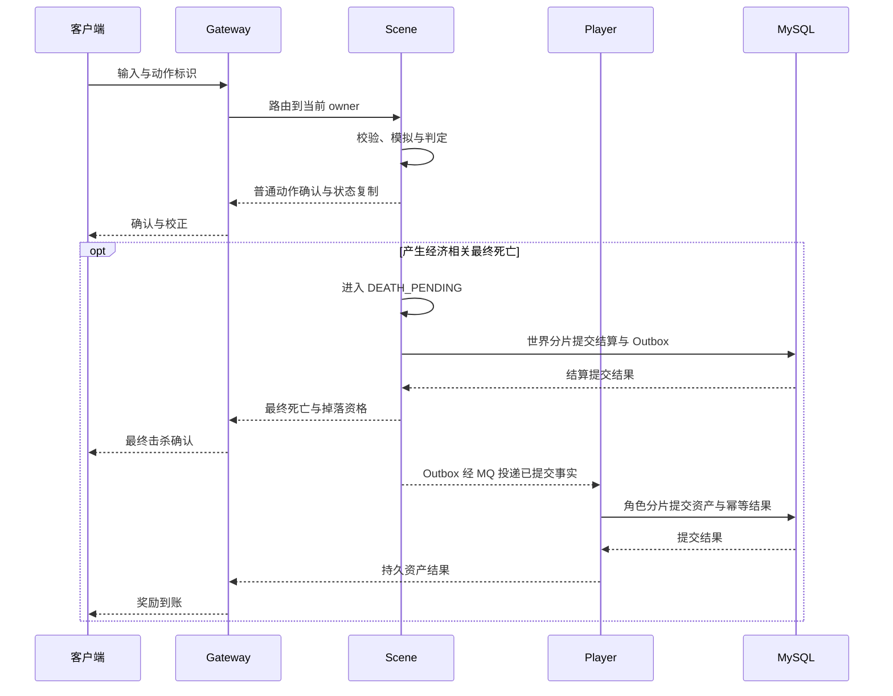
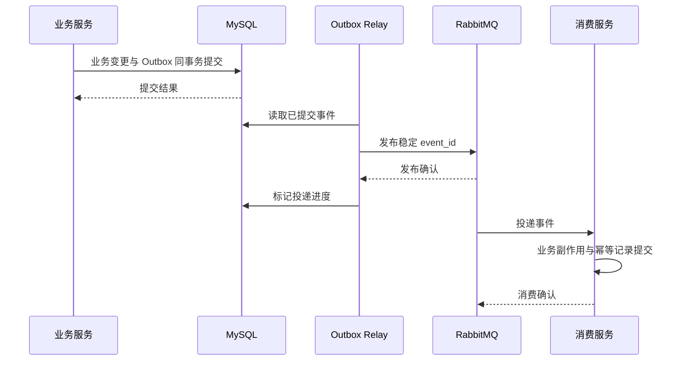

# MMORPG 分布式游戏服务器技术架构

日期：2026 年 11 月 19 日

本文定义服务端的分层、服务职责、战场权威与部署边界，作为各阶段技术设计的架构基线。

**目录**

- [1. 文档目的与架构结论](#1-文档目的与架构结论)
- [2. 技术栈](#2-技术栈)
- [3. 逻辑分层](#3-逻辑分层)
- [4. 服务职责](#4-服务职责)
- [5. 世界、空间与执行单位](#5-世界空间与执行单位)
- [6. 状态所有权](#6-状态所有权)
- [7. 通信架构](#7-通信架构)
- [8. 核心链路](#8-核心链路)
- [9. 数据与事件架构](#9-数据与事件架构)
- [10. 低延迟与资源控制](#10-低延迟与资源控制)
- [11. 部署架构](#11-部署架构)
- [12. 故障恢复](#12-故障恢复)
- [13. 更新与运维](#13-更新与运维)
- [14. 安全边界](#14-安全边界)
- [15. 容量与验收](#15-容量与验收)
- [16. 官方技术资料](#16-官方技术资料)

## 1. 文档目的与架构结论

本文件定义 MMORPG 分布式游戏服务器的服务职责、状态归属、通信关系与部署结构。系统采用 C++ 运行时、Lua 规则和关系数据库事务。场景以 Space 为权威单位，每个 Space 由同一进程内的一条逻辑线程提交状态，其余线程可并行计算只读任务。配套 TDD 定义接口、状态机与容量口径。

系统覆盖认证接入、会话角色、实时世界、公共业务、世界控制、数据与消息基础设施六个逻辑层。业务层包含十一个服务边界，并由 Gateway、GameWorker、Platform、Control 四类业务进程承载。服务边界定义数据与职责，进程角色定义资源隔离和部署方式。

集群设计目标为多个 World 合计一百万个同时在线的有效角色，负载包括角色加载、移动、战斗、状态复制、业务操作和重连。另一个独立目标是原生 PC 上 5000 人进入同一个 Space、共享战斗结果并同时参与动作战斗。在允许通视的开阔区域，每个观察者能区分其他 4999 名个体。近处精细同步，远处允许降低复制频率和动画精度。容量数字为设计目标，结果需注明实际场地、硬件、网络和玩法条件。

架构遵循以下不变量：

1. 每份可变业务状态在一个有效所有权代次内只有一个写入权威。
2. 普通移动和战斗在 Gateway 与 Scene 之间形成短链路，场景 Tick 直接使用内存状态。
3. 个人资产、业务结果与幂等记录在明确的数据库事务边界内提交。
4. 目录和缓存用于定位，持久所有权记录与接收端校验控制写入资格。
5. 网络、数据库、消息队列和重计算回调通过邮箱返回所属逻辑执行域。
6. 所有任务队列、缓存、重试和发送缓冲均具有容量上限与确定的过载处理规则。
7. 数据库提交结果、传输确认、消息消费确认和完整业务完成分别定义。
8. Lua 代码更新、运行态转换、C++ 发布和数据库结构迁移分别执行。

## 2. 技术栈

| 领域 | 采用技术 | 架构职责 |
| --- | --- | --- |
| 运行平台 | Linux | 进程、线程、网络、计时和资源控制 |
| 核心语言 | C++ | 网络运行时、调度、实体、空间计算、数据访问和控制面 |
| 游戏规则 | Lua | 技能、Buff、任务、道具、活动和 AI 决策 |
| 脚本集成 | Lua C API 与自研薄绑定层 | 对象句柄、受控宿主接口、错误隔离与生命周期管理 |
| TCP 与异步 I/O | Boost.Asio | TCP 套接字、异步读写、连接生命周期和传输计时 |
| 公网主连接 | MsQuic | QUIC 连接、可靠业务流和实时 DATAGRAM |
| 公网兼容连接 | Boost.Asio、OpenSSL | TCP 长连接，使用 Asio SSL stream 与 OpenSSL 提供 TLS |
| 认证入口 | Nginx、HTTPS | 边缘 TLS 终止、认证限流与请求转发 |
| 认证服务接口 | Boost.Beast、Boost.Asio | Nginx 终止外部 HTTPS，受控内网的 Auth HTTP 接口使用 Beast 解析和响应 |
| 内部实时通信 | Boost.Asio、OpenSSL、Protobuf | Gateway 与场景进程的批量输入和状态长连接使用 mTLS，独立交接通道传输大块状态 |
| 业务与控制接口 | gRPC、Protobuf | 服务调用、超时、身份认证和结果查询 |
| 执行模型 | Actor 邮箱、ExecutionShard、C++ 任务池 | Space 内单写提交，耗时查询在同一阶段的只读快照上并行 |
| 状态同步 | 状态 Schema、增量复制 | 按连接管理基线和实体生命周期，按交互重要性安排发送 |
| 空间组织 | Space、空间网格 Grid | Space 负责完整地图或战场的权威状态，Grid 用于空间查询和复制候选筛选 |
| 导航 | Recast、Detour | 导航资源构建和服务端路径查询 |
| 碰撞 | Jolt | 权威移动碰撞、射线与形状查询 |
| 事务数据 | MySQL、InnoDB | 资产、业务结果、所有权、流程记录和事件发件箱 |
| ORM | ODB | C++ 持久化对象映射、查询和事务访问 |
| 数据访问封装 | C++ Repository 与有界数据库执行池 | 分片路由、事务组织和异步结果投递 |
| 数据库高可用 | InnoDB Cluster、MySQL Router | 单个数据库分片内的复制和访问路由 |
| 缓存与读视图 | Redis Cluster | 可重建的展示数据、排行和辅助读模型 |
| 注册与控制协调 | etcd | 服务实例、控制候选资格、目录承载和期望放置 |
| 可靠业务事件 | MySQL Outbox、RabbitMQ quorum queues | 事务后事件投递、重试和消费隔离 |
| 文件与备份 | S3 兼容对象存储 | 地图、脚本、配置、检查点、日志归档和备份 |
| 构建与依赖 | GCC、Clang、CMake、Ninja、vcpkg | 构建描述、依赖锁定和持续集成 |
| 开发环境 | Docker、Docker Compose | 本地完整业务链路与集成环境 |
| 集群部署 | Kubernetes | 容器资源、进程生命周期与基础调度 |
| 日志 | spdlog、Loki | 结构化日志、流程关联与检索 |
| 指标 | Prometheus、Grafana | 运行指标、容量视图和告警 |
| 链路追踪 | OpenTelemetry、Tempo | 登录、资产、交易和迁移流程追踪 |
| 运行诊断 | 游戏运行指标、阶段耗时与客户端遥测 | 关联服务端调度、发送队列与 PC 出帧，定位实际运行中的问题 |
| 基础设施客户端 | redis-plus-plus、hiredis、AMQP-CPP、libev、AWS SDK for C++ | 缓存、MQ 与对象存储访问 |
| 配置与发布描述 | YAML、yaml-cpp、Protobuf 数据包、Helm | 运行配置、玩法配置与集群发布 |
| 采集客户端 | prometheus-cpp、OpenTelemetry C++、OpenTelemetry Collector | 指标与链路数据采集 |
| 密码哈希 | Argon2id、libargon2 | 账号凭据校验 |
| 制品构建 | GitHub Actions | 构建与归档版本化制品 |

公网 QUIC 的协议处理和回调由 MsQuic 管理。游戏 TCP 兼容通道与内部游戏数据长连接由 Boost.Asio 管理，TLS 和 mTLS 通过 Asio 的 OpenSSL 集成实现，Auth HTTP 由 Beast 处理。业务和控制 RPC 使用 gRPC 自身的传输及执行机制，数据库和 MQ 连接交给相应客户端库。游戏代码负责消息格式、数据寿命、预算、背压、路由及向逻辑邮箱投递。网络回调只处理有界的协议工作。[R1][R4][R15][R16]

ODB 封装在 Repository 内，持久化记录与运行时实体分离。常规持久化采用对象映射，关键条件更新与复杂查询采用参数化 SQL，并与 ODB 共享事务连接。ODB 的对象映射和原生 SQL 能力为该组合提供基础。[R7]

## 3. 逻辑分层

| 层次 | 主要职责 | 服务或基础设施 |
| --- | --- | --- |
| 接入与认证层 | 身份认证、连接维护、消息校验、限流和路由 | AuthService、GatewayService |
| 会话与角色层 | 会话绑定、选角、重连、角色业务和个人资产 | PlayerService |
| 实时世界层 | 地图实例、移动、战斗、AI、空间交互和状态复制 | SceneService |
| 公共业务层 | 社交、聊天、邮件、交易、匹配和排行 | SocialService、ChatService、MailService、MarketService、MatchService、LeaderboardService |
| 世界控制层 | 目录、承载调度、所有权交接、迁移和管理 | WorldCoordinator |
| 数据与消息层 | 事务数据、派生视图、协调元数据、可靠事件和资源 | MySQL、Redis、etcd、RabbitMQ、对象存储 |

控制面横向管理业务承载与所有权。数据与消息层服务于相应业务边界。普通场景指令直接进入 Scene，公共业务命令进入对应业务服务。

图中的 MySQL 表示持久基础设施类别，Redis 承载独立的派生读视图。业务数据访问遵守服务所有权和分片路由，连接入口由相应服务的数据访问模块持有。

## 4. 服务职责

| 服务 | 职责 | 权威状态与边界 |
| --- | --- | --- |
| AuthService | 账号认证、凭据签发、认证策略和账号风控 | 账号身份、登录凭据及认证审计 |
| GatewayService | 连接、心跳、基础协议检查、限流和消息路由 | 本机连接资源、连接绑定和带代次路由缓存 |
| PlayerService | Session、角色加载、选角、重连、成长、任务和个人资产 | PlayerActor、货币、背包、装备配置和长期角色业务 |
| SceneService | Space、Avatar、移动、战斗、AI、空间查询与复制 | 同一 Space 的实体位置与战斗状态，由其 Scene 执行分片独占提交 |
| WorldCoordinator | 目录管理、负载放置、交接协调、资源调度和管理入口 | 已提交交接流程与控制状态 |
| SocialService | 好友、黑名单、队伍、公会及关系查询 | 关系记录、队伍和公会业务对象 |
| ChatService | 频道准入、消息路由、频道广播和聊天限流 | 频道业务状态与聊天分发流程 |
| MailService | 邮件生成、投递、展示和领取流程协调 | 邮件内容、投递状态与领取流程 |
| MarketService | 订单、拍卖、托管和跨角色交易协调 | 订单状态、交易决定和托管流程 |
| MatchService | 匹配队列、组队匹配、席位预约和实例申请 | 匹配请求、队列状态和组局流程 |
| LeaderboardService | 排名读模型、周期结算和奖励计划 | 榜单周期、排名结果和结算状态 |

Session 属于 PlayerService。WorldScheduler 和 FencingAdapter 属于 WorldCoordinator。Combat、Buff、AI、AOI、Replication 属于 SceneService。Space 表示地图实例或战场，Grid 是空间索引，ExecutionShard 是由逻辑线程驱动的执行单位。

业务服务以命令和事件协作。跨服务写入通过拥有该状态的服务执行。GM 管理命令复用正式业务入口并记录审计信息。

## 5. 世界、空间与执行单位

### 5.1 地域与逻辑世界

地域是实时网络和基础设施的部署范围。World 是规则、身份与社交范围内的逻辑世界。一个 World 包含多个 Space，一个 Space 表示一份运行中的地图实例。分线、副本和独立战场分别具有独立的 Space 身份。

同一实时互动域部署在同一地域。角色归属的 World 固定，场景迁移发生在该 World 的 Space 之间。跨地域关系和业务消息通过公共业务链路传递。角色进入另一个 Space 时更新场景归属与路由，角色档案仍保留在按角色身份确定的数据分片中。百万在线由多个 World 的集群总在线构成。

### 5.2 Space、Grid 与 AOI

MapAsset 包含地形、碰撞、导航、出生点和区域定义。每个活跃 Space 以唯一的 `SpaceId` 标识，整体放置在一台 GameWorker 的一个 Scene ExecutionShard 上。Grid 把该 Space 内的空间划分为查询格，实体以本地索引记录其位置，可一次查询覆盖多个格。

角色越过网格线时，当前 Space 修改位置及 Grid 成员关系。冲刺、技能击退、高速弹体以及视野查询均可在一次模拟步长内跨越多个格。输入路由、权威身份与战场时间保持连续。显式换图和整场承载迁移的流程见 8.7 节。

AOI 按空间索引确定可见实体和观察关系。服务器分别维护权威命中候选、允许观察的个体及本次更新的字段。观察权限由玩法定义，开阔战场的远处玩家保留独立实体 ID、粗位姿与表现。接收者的准星、锁定关系和可能影响本人的技能会提升相应实体或事件的发送优先级。

Recast 与 Detour 提供导航网格和路径查询能力，Jolt 提供碰撞与查询能力。资源流水线向服务端输出统一坐标、单位、碰撞层和移动规则的数据。[R5][R6]

本项目采用 TrinityCore 的地图实例与格子分工。其普通移动在同一 Map 内调整网格成员关系，地图实例承担更新任务。观察者的进入、离开和状态变化参考 KBEngine 的 Witness。单场多核阶段与 5000 人容量目标是本项目自己的设计。[TrinityCore 地图内移动](https://github.com/TrinityCore/TrinityCore/blob/c4192c00729bfb1edf9d68dcb88e0a33b4c53e33/src/server/game/Maps/Map.cpp#L1031-L1055) · [KBEngine 观察者更新](https://github.com/kbengine/kbengine/blob/master/kbe/src/server/cellapp/witness.cpp#L774-L859)

### 5.3 战场权威与战斗时序

同一 Space 的角色、NPC 与投射物使用同一套服务器 Tick。Scene 执行分片提交该场的位置、生命值、冷却和 Buff。发送线程、查询任务和客户端使用带版本的只读数据，客户端以输入意图驱动本地预测并接收权威校正。

施法、闪避、命中和击退均在所属 Space 的阶段顺序内裁定。场景查询可覆盖多个 Grid，并对重复候选和接触对去重。投射物在同一时间轴上连续扫掠，不因网格边界暂停。目标和攻击者须属于同一 Space，其他 Space 的实体只通过换图或公共业务接口关联。动作的生效阶段、迟到输入与历史查询遵循 TDD 的战斗规则。

热点战场可以独占一个执行分片或一台 GameWorker，其他地图可单独放置。狭口拥挤时以动态接触对数、范围技实际命中数、弹道扫掠和复制字节数核算单场负载。5000 人同场目标按完整一场计算，其他实例的空闲容量不能计入该场已承载人数。

### 5.4 执行分片

每个 ExecutionShard 由一条逻辑线程独占，并持有独立 Lua VM。Player 分片承载 PlayerActor。一个 Scene 分片可以轮流调度多个轻量 Space，每个 Space 有独立时钟、状态及规则上下文。一个热点 Space 始终只有一个提交者，可独占该分片。

每个 Tick 以固定顺序采纳输入、推进运动与碰撞、裁定战斗、提交状态和发布快照。同一阶段内，工作线程读取一致的不可变数据，并行计算接触候选、技能目标或复制候选，在各自缓冲区写结果。场景线程核对任务的 Space、代次、阶段与 Tick，按稳定顺序合并结果并运行 Lua。网络、数据库和慢任务通过有界邮箱回投，各自不直接接触可变场景状态。[R13]

## 6. 状态所有权

| 状态 | 写入权威 | 复制与读取方式 |
| --- | --- | --- |
| 账号身份 | AuthService | 签发并验证受控凭据 |
| 会话与连接绑定 | PlayerService 的 Session | Gateway 保存当前有效绑定 |
| 货币、背包和装备归属 | PlayerActor 资产域 | MySQL 保存持久结果，其他服务发送业务命令 |
| 装备配置和成长数据 | PlayerActor | Scene 接收带版本的战斗属性投影 |
| 位置、朝向和移动状态 | 所属 Space 的 Scene 执行分片 | Grid 更新本地定位，客户端接收按观察者生成的复制数据 |
| 战斗 HP、MP、冷却、Buff 和仇恨 | 当前场景执行域 | 按场景复制 Schema 同步 |
| 好友、公会和队伍 | SocialService | 角色侧保存引用或派生视图 |
| 邮件内容与投递流程 | MailService | 角色领取流程使用稳定邮件和附件标识 |
| 附件到账与领取幂等结果 | PlayerActor 资产域 | 与个人资产在角色分片内提交 |
| 订单与交易决定 | MarketService | 参与方通过幂等命令推进结算 |
| 排行结算与奖励计划 | LeaderboardService | 玩家奖励由资产域持久入账 |
| 所有权与承载交接 | 分片 MySQL 的所有权账本 | 目录缓存由已提交记录重建 |
| 服务实例与控制协调 | etcd | 控制面消费 Watch 并执行一致性读取 |

角色身份、实体身份和进程身份分别表示业务对象、空间对象和运行实例。进程重新启动产生新的实例身份，不能仅凭原地址继承写入资格。

`session_epoch` 随会话重绑推进，`entity_generation` 随实体重建更新，`player_owner_epoch` 表示角色业务承载代次。Avatar 通过跨 Space 换图改变归属时推进 `avatar_owner_epoch`。整场换承载或故障接管时推进 `space_owner_epoch` 并绑定新的 `worker_instance_id`。网格索引变化沿用现有代次。

资产事务在实际写入时检查所属角色的所有权守卫与业务条件。交接事务通过同一守卫完成代次推进。目录、Redis 和进程内缓存提供的定位结果不替代该提交校验。

## 7. 通信架构

### 7.1 通道职责

| 通信关系 | 通道 | 载荷与完成语义 |
| --- | --- | --- |
| 客户端与 AuthService | HTTPS | 身份认证与登录凭据 |
| 客户端与 Gateway | MsQuic | 可靠业务消息、实体生命周期、实时输入和状态复制 |
| 客户端与 Gateway 兼容接入 | Boost.Asio TCP、OpenSSL TLS | 与 QUIC 路径一致的游戏消息语义及业务确认 |
| Gateway 与 Scene | Boost.Asio TCP、OpenSSL mTLS | 按 Space 路由批量输入、关键确认与复制消息 |
| GameWorker 与 GameWorker | Boost.Asio TCP、OpenSSL mTLS | 显式换图、整场迁移和接管的数据传送，与普通战斗输入分队列处理 |
| 业务服务之间 | gRPC 与 Protobuf | 业务命令、流程查询和幂等重试 |
| 控制面与 Worker | gRPC 与 Protobuf | 注册、资源预热、准备、冻结、激活和排空 |
| 事务后业务协作 | Outbox 与 RabbitMQ | 已提交事实与可靠后续处理 |
| 大块资源与检查点 | 对象存储和独立批量通道 | 内容校验、上传下载与迁移数据 |

QUIC 可靠 stream 承载离散指令、资产命令和生命周期消息，DATAGRAM 承载具有序号和有效期的连续输入、位置与可覆盖状态。DATAGRAM 具有不可靠交付语义并受到拥塞控制，应用层执行过时丢弃和恢复协议。[R2][R3]

TCP 兼容通道在写入发送缓冲前合并过时状态，保留离散动作和业务消息。进入 TCP 字节流的数据按序交付，其排队和重传时延单独记录。内网输入与关键事件、普通状态使用独立 TCP 连接组和发送预算。迁移快照及大块资源另走受限批量通道，后台积压独立处理。

### 7.2 状态同步

系统采用服务器权威状态同步。客户端发送输入或意图，服务器执行移动、碰撞、资源、冷却和目标条件检查。客户端本地预测配合服务器确认与校正，远端实体通过快照插值呈现。

服务器固定以 20 Hz 推进场景，每步 50 ms。普通复制发布周期是 10 Hz，调度器按字段变化、重要性和字节预算选择本轮对象，远景可跨多个周期更新。锁定目标、快速接近者、即将影响本人的投射物与范围预警进入优先发送路径。客户端插值与动画更新独立于场景及复制节拍。

实体进入观察范围和客户端重连时建立完整基线。增量消息引用客户端已确认的基线。实体创建、销毁和重建携带实体代次，迟到消息不能作用于同标识的新对象。尚未建立的实体状态进入有界缓冲，缓冲超限或超时触发基线重建。缺失基线时停止应用依赖该基线的增量并请求重建。普通复制以观察者和实体复制块为序列范围，不同块的更新独立应用。

### 7.3 确认层次

协议区分传输送达、服务受理、权威执行完成、持久化完成和完整业务完成。普通施法结果对应权威判定，资产成功对应已提交事务，跨分片交易成功对应参与方完成持久结算。

每个请求根据消息类别携带稳定操作标识、身份、会话代次、实体代次、所有权代次、输入序号和逻辑时间。重试沿用原业务标识，结果查询返回该业务的已有状态。

## 8. 核心链路

### 8.1 登录与进入场景

1. 客户端通过 HTTPS 完成账号认证，取得短期登录凭据。
2. Gateway 验证凭据并建立受控连接，执行包大小、频率和协议检查。
3. PlayerService 的 Session 建立连接绑定并推进会话代次，旧绑定随之失效。
4. 角色目录定位 PlayerActor。角色执行域取得合法所有权并从固定数据分片加载角色和未决操作。
5. PlayerActor 校验进入条件，WorldCoordinator 查找或分配目标 Space，并返回其 GameWorker、权威代次与席位。
6. Scene 创建准备中的 Avatar，加载资源与角色战斗属性投影，完成实体归属登记。
7. Scene 激活目标 Avatar，Gateway 安装当前 Space 的带代次路由。
8. 客户端先安装本人、周边交互对象与即时威胁的基线，按入场协议开放控制并分批补齐远景个体。集中进场期间单独记录全员基线就绪时间。

整个进入流程使用稳定请求标识。重试读取已有流程状态，失败流程释放席位预约和准备对象。

### 8.2 普通移动与战斗

Gateway 根据角色的当前 Space、场景承载代次和 Worker 身份直接转发输入。Scene 校验输入序号、会话与实体代次、动作条件和有效时窗，按同一 Space 的 Tick 处理角色、NPC 与投射物。跨格查询、阻挡、击退和命中都在本次场景调度内完成。

场景本地维护战斗 HP、MP、冷却与临时资源。普通动作使用当前合法的内存状态，权威结果进入高优先级发送队列，普通位置和表现数据进入状态复制队列。

图中的 MySQL 表示世界与角色两类独立数据分片。具有经济结果的出生实例在生成时持久保存 life_id，检查点恢复保持同一身份。致死判定先进入 DEATH_PENDING，最终击杀与掉落资格在结算提交后确认。奖励链路发生在明确的持久结算边界，结算事实由独立数据库执行器在世界元数据分片写入，Outbox 经 RabbitMQ 将已提交事实投递至角色资产分片。场景表现、战斗结果与资产到账分别具有完成点。已确认的资产结果通过幂等记录恢复，场景回退不重复发放同一结算奖励。

### 8.3 购买与个人资产变更

Gateway 将包含 `operation_id` 的资产命令交给合法 PlayerActor。角色执行域校验规则并建立操作中的资源预留，同一资产域内的冲突操作遵守串行化规则。

数据库执行器在角色固定分片中启动事务，在同一连接上校验所有权守卫、操作幂等记录和资产条件，提交余额、物品、业务标记、流水、结果与 Outbox。事务结果返回所属逻辑线程，逻辑线程应用已提交结果并通知客户端。

提交连接中断或调用超时进入结果查询流程。查询和重试沿用相同的 `operation_id`。未判定结果的操作保持未决状态，恢复流程通过持久记录确定后续动作。

### 8.4 邮件附件领取

MailService 维护邮件内容、投递状态和不可变附件定义，并通过 Outbox 将接收者、有效期和 grant_id 组成的领取授权安装到角色分片。授权安装成功后邮件进入可领取状态。领取命令携带稳定的邮件标识、附件批次与领取操作标识，进入 PlayerService 的资产入口。

PlayerService 在角色分片内，将授权检查与消费、附件领取幂等记录、资产入账、流水和 Outbox 置于同一事务。MailService 根据已提交的领取事实更新展示状态。角色授权以接收者与 grant_id 唯一标识，授权安装不覆盖已领取或已撤销终态；先到的撤销建立墓碑，后到的安装保留撤销状态。重复领取返回既有结果，邮件展示延迟不影响资产唯一入账。

### 8.5 市场与跨分片交易

MarketService 持久保存交易流程、参与方、资源预留、每步结果和业务决定。托管资源从玩家可消费资产中移出，并以明确的托管状态归属交易流程。

交易依次执行预留、持久提交决定、参与方幂等结算和终态确认。提交决定一旦持久化，恢复流程持续推进结算。未进入提交决定的失败交易执行释放流程。超时先查询既有决定和参与方状态。

市场交易统一使用持久预留与全局决定协议。同分片参与方在相应阶段通过一个本地事务合并提交，跨分片参与方分别完成本地事务。客户端在全体参与方持久结算完成后收到交易成功。

### 8.6 实时消耗品

Player 先在角色分片持久扣除物品，保存 item_use_operation 与 Outbox。Scene 接收已提交事实后，在世界分片将 APPLY_COMMITTED 或 CANCEL_COMMITTED 效果决定、恢复结果与结果 Outbox 放入同一事务。两个决定在同一 effect_decision 记录上互斥。Scene 的 APPLIED 表示效果应用进度；角色分片的 item_use_operation 保存道具扣除与补偿终态。

Scene 对受影响实体建立短暂业务屏障，提交效果结果后应用状态并解除屏障。检查点记录已应用效果序列，恢复过程应用检查点之后的结果字段。确定取消的事实通过角色资产入口，在同一事务中完成道具恢复、补偿流水、操作终态和 Outbox；结果未知时查询原操作。Avatar 已离场时，世界恢复任务依据已隔离的旧执行域和持久离场身份，为未决操作提交确定的取消决定。整个场景继续调度其他实体。

### 8.7 角色与场景迁移

持久所有权交接适用于 PlayerActor 转移、Avatar 显式换 Space、整 Space 换 Worker 三类操作。换图事务在同一世界元数据分片先锁 `control_guard`，再按 SpaceId 顺序锁源、目标 `space_guard`，随后锁 `avatar_owner` 与交接记录。核对双方场景状态后提交目标 Space 并推进 `avatar_owner_epoch`。整场迁移以 `space_guard` 协调进出场，等待已开始的换图完成或取消，再冻结整个 Space、推进 `space_owner_epoch` 并更新承载。场内实体沿用其 `avatar_owner_epoch`。角色业务承载另由角色分片守卫串行交接。

1. 控制面预约目标资源并创建只读准备对象。
2. 源端建立一致快照并复制变更，目标追赶至受控边界。
3. 源端在明确的逻辑边界冻结状态，记录最终序号并处理未决异步操作。
4. 目标接收完整状态并提交就绪结果，最终恢复包写入对象存储并完成校验，交接记录引用该包的位置与摘要。
5. 固定分片中的事务校验旧归属、旧代次和交接状态，提交新 owner 与新代次。
6. 控制面核对源执行域冻结或进程隔离证据，接收端建立新的写入隔离，目标激活，目录和 Gateway 更新路由。
7. 目录切换后，源端在保留期内只转发带原业务标识的在途命令。跨图客户端重建目标 Space 的观察基线，整场迁移的客户端按新场景承载代次接受权威更新。

交接超时通过 `transfer_id` 查询持久结果。恢复流程根据已提交归属推进目标激活或源端取消。权威交接提交后的后续故障通过新的所有权代次恢复。

## 9. 数据与事件架构

### 9.1 数据分类

| 数据类别 | 存储与恢复方式 | 完成边界 |
| --- | --- | --- |
| 个人资产与领取结果 | MySQL 本地事务、幂等记录和流水 | 已提交事务 |
| 订单与跨服务业务 | MySQL 持久状态机和参与方记录 | 业务终态 |
| 所有权与交接 | 固定分片的条件事务和交接日志 | 有效代次提交 |
| 实时场景运行态 | 内存模拟、检查点和恢复日志 | 场景恢复策略 |
| 展示缓存与排行读视图 | Redis 和可重放业务事件 | 读模型的消费进度 |
| 地图、脚本与配置 | 对象存储和只读本地缓存 | 内容校验与发布清单 |

角色数据通过 `hash(character_id)` 映射到稳定逻辑桶，再由桶路由到物理分片。空间迁移保持角色数据库归属不变。同一 World 的 `space_guard`、`avatar_owner`、`entity_life`、`settlement`、`effect_decision` 与 `transfer` 共置于按 `world_id` 路由的世界元数据分片。场景经济事实与 Outbox 在世界分片提交，角色分片按业务标识幂等入账。每个数据库分片采用单主写入的 InnoDB Cluster，并通过 MySQL Router 访问。[R8]

在线 PlayerActor 的内存是业务工作状态。Redis 保存可重建读视图，资产判定与变更使用合法 owner 和受控事务。读视图更新携带版本，消费者处理重复与乱序，重建流程从持久源重新生成数据。

### 9.2 Outbox 与 RabbitMQ

生产者将业务变化和 Outbox 放入同一本地事务。Relay 读取已提交事件，以固定事件标识发送到 RabbitMQ，并处理发布确认和无法路由结果。只有收到该次发布的 Confirm ACK 且未收到对应 basic.return 才标记投递成功；退回、NACK 和断连保持原事件未完成。

消费者将业务副作用与 Inbox 去重记录放入本地事务，提交后确认消息。涉及远端副作用的消费者通过幂等命令或新的 Outbox 延续业务流程。进入 Actor 邮箱表示受理，持久完成后才确认本阶段消费。

RabbitMQ 的发布确认和消费确认分别覆盖不同阶段；Outbox 衔接数据库提交与消息投递；业务幂等记录控制重试产生的重复效果。[R9][R10]

发布确认与消费者收到事件的先后顺序由独立链路决定，图示只表达各自的业务步骤。

队列按业务订阅和逻辑分片组织。关键持久业务采用 quorum queue，同一消费组分担处理，不同业务订阅分别接收事件。重试采用退避和上限，失败事件进入隔离流程并保留恢复入口。[R11]

### 9.3 场景检查点与数据库恢复

Scene 每五秒为每个 Space 生成一次一致检查点，由后台执行器上传。检查点保存该 Space 的模拟 Tick、实体和投射物状态、稳定生命身份、效果应用序列及规则资源标识。最近成功检查点落后超过十秒时，该 Space 暂停新增经济终态与新角色准入。实际恢复位置取决于最近成功保存的检查点。

恢复先还原检查点，再对齐其后的持久死亡、结算与效果决定。

检查点、效果决定和关键生命周期记录携带同一 life_id 下递增的 state_seq。检查点记录已包含的序列水位，恢复过程按序应用水位之后的关键结果。较早的效果结果不覆盖较晚的死亡或生命周期终态，原 life_id 的结果不应用到重生后的新生命实例。客户端重建完整复制基线。资产、所有权和交易决定依据数据库提交记录恢复。

每个生产数据库分片使用三个成员与单主写入拓扑，关键提交执行日志落盘、binlog 同步与跨成员应用确认。多数派不可用期间停止新的关键提交。备份每天生成完整副本并持续归档日志，恢复先核定数据边界再开放写入。

### 9.4 所有权与控制元数据

etcd 管理服务实例、控制协调与期望放置。分片 MySQL 的所有权账本保存实际生效的角色业务归属、Avatar 所在 Space 及 Space 承载实例。每个权威分片的 `control_guard` 记录控制实例、任期与数据库时钟租约。取得 etcd 候选资格的控制实例在旧数据库租约失效后，锁定该守卫并递增任期接管。所有权变更在同一分片事务内锁定控制守卫与对象守卫。过期的原任期不能通过续租恢复。

接收端拒绝已失效 owner 发出的新写命令。旧 owner 在有效期内合法提交、之后才送达的事件，根据持久提交事实与业务幂等标识继续处理。有效历史事实与过期运行时命令分别校验。

Watch 与进程内目录用于路由刷新。服务租约和目录缓存不直接授予外部资源的写入权限，外部副作用由对应接收端实施隔离。[R12]

## 10. 低延迟与资源控制

### 10.1 实时路径

普通移动与战斗的关键路径为客户端、Gateway、Scene、Gateway、客户端。场景执行期间直接读取所属执行域内的状态，数据库、MQ、etcd 和公共业务服务在各自的异步路径工作。

场景 Tick 分别核算输入、运动、技能、Lua、候选计算、有序合并及复制准备的时长。邮箱限制条数、字节数及消息年龄。大规模同时施法时统计实际目标数、临近威胁的排队年龄与每条连接的发送量。

离散动作与关键确认具有高优先级。连续状态根据实体和字段合并，陈旧快照被新状态替换，生命周期和经济命令保持完整。慢客户端触发发送降频、重新建立基线和连接关闭流程。

### 10.2 隔离边界

| 资源 | 隔离方式 |
| --- | --- |
| 网络 I/O | 回调只执行有界协议工作，游戏规则进入逻辑邮箱 |
| Lua VM | 每个执行分片独占，脚本执行与 GC 计入分片预算 |
| 数据库 | 独立有界执行池、分片连接预算、事务超时和未决结果查询 |
| MQ 消费 | 独立并发与预取预算，后台积压独立治理 |
| 迁移 | 独立批量通道、CPU 与带宽预算、冻结窗口管理 |
| 日志与追踪 | 异步写入、受控采样和有界缓冲 |
| 空间查询 | 按 Space 与 Tick 组织只读阶段任务，各任务独立输出候选，提交线程合并结果并记录最慢阶段 |

### 10.3 时延口径

系统分别记录入口网络耗时、Gateway 路由耗时、邮箱等待、Tick 判定耗时、输出排队、客户端权威确认和客户端呈现耗时。分位数指标按地域、场景类型与操作类别统计。

本地预测反馈、权威确认和远端插值呈现使用不同指标。输入到达相位、模拟节拍、发送节拍和网络拥塞分别计入时延分析。

## 11. 部署架构

### 11.1 四类业务进程

| 进程角色 | 承载服务 | 资源与安全边界 |
| --- | --- | --- |
| Gateway | GatewayService | 公网连接、消息入口、协议处理与路由 |
| GameWorker | PlayerService、SceneService | Player 与 Scene 使用不同执行分片及独立 Lua VM |
| Platform | AuthService 与六个公共业务服务 | 各业务具有独立邮箱、连接预算和并发限制 |
| Control | WorldCoordinator 与管理入口 | 控制任期、目录、调度、交接与审计 |

Nginx 终止认证 HTTPS，经受控内网转发至 Platform 中基于 Boost.Beast 和 Boost.Asio 的 Auth HTTP 端点。游戏客户端通过 MsQuic 或带 TLS 的 Asio TCP 连接接入 Gateway。服务间业务调用经 gRPC，内部通道验证双方身份。

四类进程分别建立副本池。GameWorker 同时承载两类执行分片，PlayerActor 与其 Avatar 通过统一消息契约协作。进程内投递与跨进程投递遵守相同身份、所有权和业务完成语义。

MySQL、Redis、etcd、RabbitMQ 与对象存储独立部署。业务副本和数据副本按故障域分散，基础设施访问通过受控网络和服务身份执行。

### 11.2 进程调度与游戏负载调度

Kubernetes 管理容器资源与进程生命周期。[R14] WorldScheduler 按完整 Space 和 PlayerActor 管理放置，监控每场的计算、内存和出口余量。新增副本可接纳新战场或承接完整 Space 的迁移。

新增 GameWorker 完成注册、依赖检查、地图与脚本预热后进入可承载状态。缩容依次执行排空标记、停止接收新负载、迁移或结束现有实例、确认写权释放和进程退出。

调度输入包括每场及每分片的 Tick 尾延迟、邮箱年龄、接触对、弹道数、范围技目标数、复制字节、内存和整场迁移成本。预期出现大型会战时可为该 Space 预留计算与发送资源。运行中的热点可迁到合适的单台 Worker，场内的并行来自只读计算任务。

## 12. 故障恢复

| 故障对象 | 恢复动作 | 正确性边界 |
| --- | --- | --- |
| Gateway | 客户端重连、推进会话代次、恢复路由和复制基线 | 旧连接和旧会话消息失效 |
| Player 执行分片 | 取得新所有权、加载资产、查询未决操作 | 已提交资产保持业务幂等 |
| Scene 执行分片 | 隔离旧写权，按受影响 Space 分别恢复完整检查点、关键结算及复制基线 | 同场参与者恢复到同一场景检查点，已确认的经济事实分别对齐 |
| Control | 接续有效任期、重建目录、读取交接记录 | 依据持久记录继续迁移和激活 |
| RabbitMQ 或消费服务 | 保留 Outbox、恢复发布与消费、重放幂等事件 | 消息重投保持业务结果一致 |
| MySQL 主节点 | 路由切换、恢复写入口、查询未知提交 | 已确认资产和所有权提交遵守数据库故障验收要求 |
| Redis | 从持久源和业务事件重建 | 资产与所有权不依赖缓存恢复取得写权限 |

恢复顺序为写权隔离、状态恢复、业务未决处理和路由开放。新的 Scene owner 激活前，控制面取得源执行域确认冻结、可信节点确认原进程实例退出、基础设施完成节点断电隔离三种证据之一。FencingAdapter 记录证据与对应进程实例，交接流程检查该记录。心跳超时和 Pod 删除不构成实时写权隔离证据；无法完成隔离的场景保持恢复中。Kubernetes 创建的新进程先取得合法承载资格，再恢复并激活游戏对象。

## 13. 更新与运维

### 13.1 更新分类

| 更新对象 | 执行机制 | 一致性边界 |
| --- | --- | --- |
| 玩法配置 | 校验、预加载、引用切换 | 资源关联和业务生效范围 |
| Lua 代码 | 预加载，在目标 Space 的 Tick 安全点切换版本引用 | 对应 Space 的规则上下文、旧闭包、协程与定时器生命周期 |
| 运行态 Schema | 显式转换、校验和恢复记录 | 实体字段与业务状态机 |
| C++ 程序 | 新进程部署、排空、迁移与接管 | 二进制协议、状态格式和写权交接 |
| 数据库结构 | 兼容性迁移、数据转换和访问切换 | 新旧代码共存与持久数据格式 |

场景规则以完整 Space 为灰度单位。WorldCoordinator 发出发布决定，该 Space 的唯一提交者在本地 Tick 安全点完成所需的状态转换，并安装活动 `ruleset_id` 与 `config_id` 后继续推进。共享同一 Scene 分片的其他 Space 仍使用各自的版本上下文。Player 规则以 Player ExecutionShard 为灰度单位。

发布决定以 `release_id` 保存在世界元数据分片。决定提交前的失败取消切换并沿用原规则，决定提交后的故障按已提交决定完成恢复与安装。恢复与安装期间只暂停目标 Space 的执行。进行中的跨域操作保留原规则与配置标识。

同一 Lua VM 可保留多个规则版本的模块注册表。宿主按当前 Space 选择规则上下文，旧任务和定时器保留其版本引用。运行态 Schema 变化前，先完成或持久登记相关旧任务，再转换状态。转换失败时沿用原状态。

发布包包含代码、配置、资源、状态 Schema、协议清单和校验信息。发布过程依次执行构建检查、预加载、灰度切换、指标核对和范围扩大。回退遵守代码、运行态与数据库格式各自的兼容约束。

### 13.2 可观测性

| 维度 | 关键指标 |
| --- | --- |
| 网络 | 在线会话、RTT、丢包、重连、发送积压与消息年龄 |
| 场景 | 每场 Tick 与阶段尾延迟、调度迟到、接触对、弹道、技能目标数、AOI 扇出、客户端状态新鲜度与预警提前量 |
| 脚本 | 执行耗时、内存分配、GC 停顿和脚本错误 |
| 资产 | 事务耗时、未决操作、重复请求和对账差异 |
| 可靠事件 | Outbox 最老年龄、发布失败、消费积压和隔离消息 |
| 迁移 | 准备时间、冻结时间、交接结果和路由收敛 |
| 控制 | 实例可用性、任期变化、排空进度和调度失败 |

日志与追踪携带角色、实体、场景、请求、交易和交接标识。指标标签使用受控维度，高基数业务标识保存在日志和追踪中。

## 14. 安全边界

客户端输入经过身份、权限、包大小、频率、序号、时间窗口和业务状态检查。客户端提交意图，Scene 根据权威数据执行判定。

服务间连接使用身份认证和受控网络访问。资产、所有权和管理接口校验调用者权限及目标业务状态。登录凭据、重连凭据和业务幂等标识分别承担身份、连接恢复和重复执行控制职责。

脚本和资源包通过发布清单与内容校验加载。Lua 通过受控接口访问宿主能力，执行分片限制脚本运行时间、内存和查询预算。管理操作记录操作者、目标对象、参数和执行结果。

## 15. 容量与验收

在约定负载下，设计时延目标为场景 Tick 执行 p99 不超过 35 ms，同一 Space 的普通权威确认 p99 不超过 100 ms，普通已发布状态从采样到网关交给发送接口的时长 p99 不超过 200 ms，单角色资产操作 p99 不超过 300 ms。其中普通确认从 Gateway 完成接收开始，资产操作从 Player 受理计至持久结果回投。客户端从上次安装的状态采样时刻起另计状态年龄，按近景、远景和即时威胁分别统计，以覆盖长时间未收到更新的对象。PC 的帧时间、预警提前量与公网 RTT 独立记录。

百万在线按多个 World 的有效角色分别统计其行为、地图分布与业务发生率。5000 人战场单独记录同一 Space 的实际入场及参战人数、可见个体数、拥挤区域角色密度、活跃弹道数、每秒施法数及目标数，并注明服务器硬件、PC 型号、画质分辨率与链路条件。其他 Space 的人数、被拒绝的席位和纯旁观连接均不得计入已参战人数。

单场位姿下行有效载荷按每名观察者各精度档的“人数 × 发送频率 × 单条字节数”求和，再汇总所有接收者。开阔地 5000 人两两可见时共有 24,995,000 条有向观察关系。计算还须计入技能事件、协议开销、基线和弱网突发。关键目标状态及预警按受影响参与者及时发送，远处每名个体保留独立表现。

| 验收维度 | 验收内容 |
| --- | --- |
| 功能链路 | 登录、选角、移动、战斗、切图、购买、邮件、交易、匹配与重连 |
| 百万在线 | 一百万有效会话下的角色、场景、复制、业务和重连混合负载 |
| 5000 人同屏动作战场 | 单个 Space 同时接纳 5000 名可战斗角色，开阔地允许各自看到其余 4999 个体，考察狭口阻挡与滑动、击退、远处预警、跨格弹道、实际帧时间与状态新鲜度 |
| 弱网 | 延迟、抖动、丢包、乱序、断连与重新同步 |
| 持久正确性 | 重复命令、超时未知结果、数据库切主与资产对账 |
| 所有权 | 旧 owner 写入、交接超时、目标激活失败与并发迁移 |
| 消息恢复 | 重投、乱序、消费者重启、Outbox 积压与隔离消息恢复 |
| 发布 | Lua 灰度、旧协程、运行态转换、C++ 排空和兼容性迁移 |
| 运维 | 资源扩缩容、控制面恢复、依赖故障与备份恢复 |

上表和配套 TDD 规定设计目标和容量口径。实际达成情况以对应部署与玩法负载下的运行记录为依据。

## 16. 官方技术资料

以下资料说明所采用组件的基础能力和机制。本文中的服务划分、状态归属、协议与资源控制规则属于本项目架构定义。

| 标识 | 资料 | 引用范围 |
| --- | --- | --- |
| R1 | [Microsoft MsQuic Execution](https://microsoft.github.io/msquic/msquicdocs/docs/Execution.html) | I/O 回调与执行模型 |
| R2 | [IETF QUIC Transport](https://www.rfc-editor.org/rfc/rfc9000.html) | QUIC 连接与可靠流 |
| R3 | [IETF QUIC DATAGRAM](https://www.rfc-editor.org/rfc/rfc9221.html) | 不可靠数据报与拥塞控制 |
| R4 | [gRPC Core Concepts](https://grpc.io/docs/what-is-grpc/core-concepts/) | RPC 与消息接口 |
| R5 | [Recast Navigation](https://recastnav.com/) | 导航网格与路径查询 |
| R6 | [Jolt Physics](https://github.com/jrouwe/JoltPhysics) | 物理与碰撞能力 |
| R7 | [ODB Official Manual](https://www.codesynthesis.com/products/odb/doc/odb-manual.pdf) | 对象映射、事务与原生 SQL |
| R8 | [MySQL InnoDB Cluster](https://dev.mysql.com/doc/mysql-shell/en/mysql-innodb-cluster.html) | 数据库分片内部高可用 |
| R9 | [RabbitMQ Publisher Confirms and Consumer Acknowledgements](https://www.rabbitmq.com/docs/confirms) | 发布与消费确认 |
| R10 | [AWS Transactional Outbox Pattern](https://docs.aws.amazon.com/prescriptive-guidance/latest/cloud-design-patterns/transactional-outbox.html) | 数据库与事件投递衔接 |
| R11 | [RabbitMQ Quorum Queues](https://www.rabbitmq.com/docs/quorum-queues) | 可靠业务队列 |
| R12 | [etcd Documentation](https://etcd.io/docs/) | 服务协调、租约与 API 语义 |
| R13 | [Lua Reference Manuals](https://www.lua.org/manual/) | 宿主接口、状态和协程 |
| R14 | [Kubernetes Horizontal Pod Autoscaling](https://kubernetes.io/docs/concepts/workloads/autoscaling/horizontal-pod-autoscale/) | 进程资源与副本调度 |
| R15 | [Boost.Asio SSL](https://www.boost.org/doc/libs/latest/doc/html/boost_asio/overview/ssl.html) | TCP 异步 I/O 和 OpenSSL 集成 |
| R16 | [Boost.Beast](https://www.boost.org/doc/libs/latest/libs/beast/doc/html/index.html) | 基于 Asio 的 HTTP 解析与响应 |
