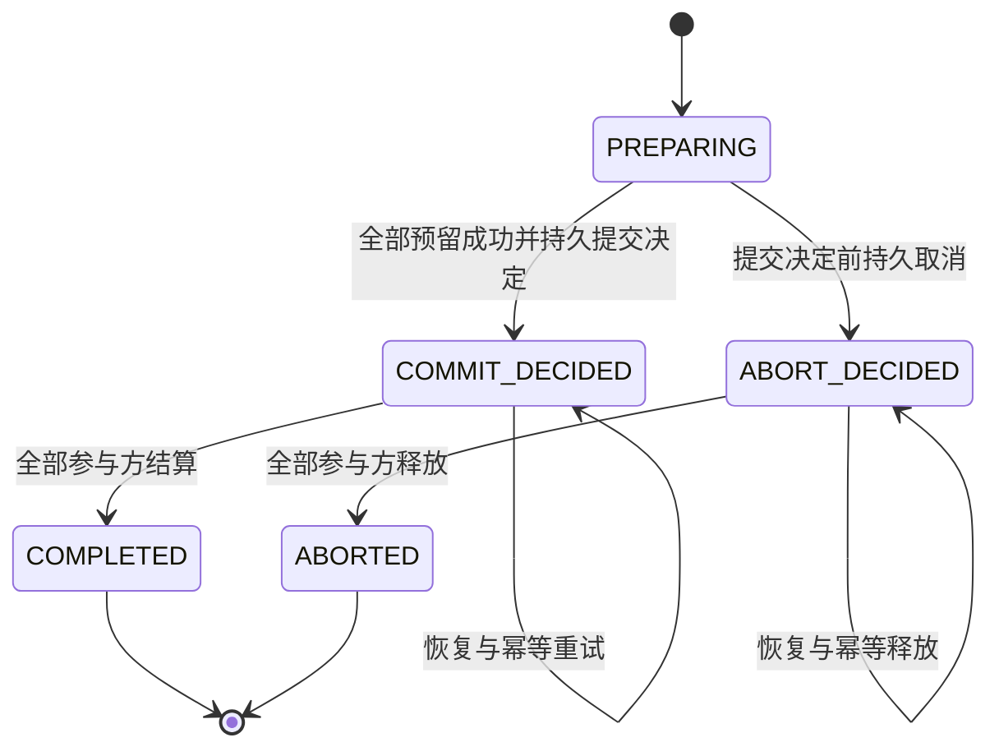

# MMORPG 分布式游戏服务器技术设计文档 TDD

日期：2026 年 11 月 19 日

文档性质：服务端技术实现基线与运行契约。

本文件定义 MMORPG 服务端的运行时结构、通信契约、战场权威、业务事务、迁移与发布流程。配套《MMORPG 分布式游戏服务器技术架构》描述系统分层、服务边界与部署关系。

本文的运行频率、时延和容量为设计目标。实际上线容量取决于部署资源、玩家互动密度、状态扇出和目标 PC 的渲染成本。

**目录**

- [1. 范围与设计不变量](#1-范围与设计不变量)
- [2. 确定技术栈](#2-确定技术栈)
- [3. 进程模块与代码组织](#3-进程模块与代码组织)
- [4. 执行模型与线程归属](#4-执行模型与线程归属)
- [5. 通信与消息协议](#5-通信与消息协议)
- [6. 场景模拟与状态同步](#6-场景模拟与状态同步)
- [7. Lua 接口与热更新](#7-lua-接口与热更新)
- [8. 持久化与数据访问](#8-持久化与数据访问)
- [9. 所有权与迁移](#9-所有权与迁移)
- [10. 资产与经济业务](#10-资产与经济业务)
- [11. 可靠事件与消息队列](#11-可靠事件与消息队列)
- [12. 服务接口与会话](#12-服务接口与会话)
- [13. 配置资源与发布](#13-配置资源与发布)
- [14. 部署与安全](#14-部署与安全)
- [15. 故障恢复](#15-故障恢复)
- [16. 可观测性](#16-可观测性)
- [17. 容量目标与故障契约](#17-容量目标与故障契约)
- [18. 官方技术资料](#18-官方技术资料)

## 1. 范围与设计不变量

系统采用 Linux、C++、Lua 和 MySQL。C++ 承担网络、调度、实体、空间计算、数据访问和集群控制；Lua 承担技能、Buff、任务、道具、活动和 AI 决策。

系统采用服务器权威状态同步。客户端发送操作意图，Scene 执行权威模拟。个人资产由 Player 资产域组织变更，数据库事务保存持久结果。

系统包含六个逻辑层和十一个服务边界，由 Gateway、GameWorker、Platform、Control 四类业务进程承载。集群目标为多个 World 合计一百万个同时在线的有效角色会话。单场目标为同一 Space 内 5000 名 PC 动作游戏玩家全部入场、共享战斗结果，在开阔无遮挡视角下每个观察者可见其余 4999 个个体，远景允许降频和简化动画。

### 设计不变量

| 编号 | 设计不变量 |
| --- | --- |
| INV-01 | 每份可变状态在一个有效代次内只有一个写入权威。一个活动 Space 在一台 GameWorker 上由一个 Scene ExecutionShard 有序提交战斗状态。 |
| INV-02 | 逻辑线程独占其状态与 Lua VM，异步结果通过邮箱返回。 |
| INV-03 | 普通场景 Tick 使用内存状态，不同步等待数据库、MQ、etcd 或公共业务。 |
| INV-04 | 资产结果、关键经济事实与交接结果在对应持久完成点之后确认。 |
| INV-05 | 重试沿用原业务标识，提交结果未知进入查询流程。 |
| INV-06 | 迁移提交与实际副作用执行分别实施所有权校验。 |
| INV-07 | 所有队列和缓冲均设置条数、字节数、年龄与过载处理。 |
| INV-08 | Lua 发布、运行态转换、C++ 发布、数据库迁移分别执行。 |

## 2. 确定技术栈

| 领域 | 技术 | 使用职责 |
| --- | --- | --- |
| 系统平台 | Linux | 进程、线程、网络、计时和资源隔离 |
| 核心语言 | C++ | 网络、运行时、实体、空间、持久化和控制面 |
| 玩法语言 | 官方 Lua 解释器 | 技能、Buff、任务、道具、活动和 AI 决策 |
| 脚本绑定 | Lua C API、自研薄绑定层 | 句柄、宿主接口、错误处理、状态访问 |
| TCP 运行时 | Boost.Asio | io_context 处理异步连接、读写与计时器，连接执行器串行化会话状态 |
| TCP 安全 | Boost.Asio SSL、OpenSSL | 公网 TCP 兼容连接使用 TLS，内网实时长连接使用 mTLS |
| 公网游戏主传输 | QUIC、MsQuic | 可靠流与不可靠状态数据报 |
| 公网游戏兼容传输 | TCP、TLS | QUIC 建连失败后的游戏连接 |
| 账号入口 | Nginx、HTTPS | 边缘认证入口、限流和转发 |
| Auth 服务端点 | Boost.Beast、Boost.Asio | Nginx 转发至受控内网的 HTTP 接口，Beast 处理 HTTP 解析与响应 |
| 内网实时通道 | Boost.Asio、OpenSSL、TCP、mTLS、Protobuf | Gateway 与 Scene 按战场批量传递输入、权威事件与复制状态 |
| 业务与控制 RPC | gRPC C++、Protobuf | 服务调用、显式换图和承载交接、截止时间与结果查询 |
| 状态复制 | 自研状态 Schema、增量编码 | 字段、量化、基线与生命周期 |
| 并发模型 | Actor 邮箱、ExecutionShard | 分片单线程、异步业务状态机 |
| 空间组织 | Space 与本地 Grid、分层网格 AOI | Space 承担战场权威。Grid 用于本地实体定位、碰撞粗筛和观察查询 |
| 导航 | Recast、Detour | 离线烘焙、运行时导航和路径查询 |
| 碰撞 | Jolt | 权威移动、射线与形状扫掠 |
| 数据库 | MySQL、InnoDB | 资产、所有权、幂等结果与持久流程 |
| ORM | ODB、libodb-mysql | C++ 持久化对象映射 |
| 数据访问 | C++ Repository、事务上下文、数据库执行池 | 分片路由、事务组织与结果回投 |
| 数据库复制与路由 | InnoDB Cluster、MySQL Router | 分片内部单主写入和故障切换 |
| 缓存 | Redis Cluster | 展示读模型、排行榜、短期认证票据 |
| Redis 客户端 | redis-plus-plus、hiredis | Redis 访问与连接管理 |
| 服务与控制协调 | etcd | 注册、控制候选资格、目录与期望放置 |
| etcd 客户端 | gRPC 生成客户端、自研适配层 | 租约、事务、Watch 与重新同步 |
| 消息队列 | RabbitMQ quorum queues | 持久业务事件与消费隔离 |
| MQ 客户端 | AMQP-CPP、libev | 专用事件线程、发布确认与消费确认 |
| 可靠事件 | MySQL Outbox、Inbox、业务幂等记录 | 事务后投递与重复执行控制 |
| 对象存储 | S3 兼容对象存储、AWS SDK for C++ | 资源包、检查点、恢复包和备份 |
| 运行配置 | YAML、yaml-cpp | 进程启动配置与运行资源预算 |
| 玩法配置 | Protobuf 数据包 | 类型校验、引用校验和不可变配置快照 |
| 编译与依赖 | GCC、Clang、CMake、Ninja、vcpkg | 构建、编译检查和依赖锁定 |
| 本地部署 | Docker、Docker Compose | 完整开发与集成环境 |
| 集群部署 | Kubernetes、Helm | 进程承载、资源约束与发布描述 |
| 日志 | spdlog、Loki | 异步结构化日志与检索 |
| 指标 | prometheus-cpp、Prometheus、Grafana | 指标采集、存储、展示与告警 |
| 追踪 | OpenTelemetry C++、OpenTelemetry Collector、Tempo | 业务链路与异步流程关联 |
| 密码哈希 | Argon2id、libargon2 | 账号凭据校验 |
| 运行观测 | 客户端与服务端遥测 | Tick 阶段耗时、消息年龄、单连接带宽、目标 PC 帧时间 |
| 持续集成 | GitHub Actions | 服务构建与制品发布 |

MsQuic 由自身执行线程分派 QUIC 回调。适配器在回调返回前把接收数据复制到受控缓冲，发送缓冲由适配器持有至对应发送完成或允许释放的通知。Boost.Asio 的 I/O 线程与 gRPC C++ 运行时分别驱动自己的异步操作，三者将有界值消息投递到逻辑邮箱。Asio 每连接使用串行执行器和有界写队列，同一时刻仅发起一次异步写，完成回调释放当前缓冲并启动下一次写入。[R1][R4][R21][R22]

ODB 编译器作为构建工具生成映射代码，生成结果与服务代码共同编译。ODB 运行库和 MySQL 后端采用其官方 GPL／商业双许可条款，依赖清单保留实际采用的许可文本与来源。[R7][R18]

## 3. 进程模块与代码组织

### 进程与模块

| 进程 | 服务模块 | 运行边界 |
| --- | --- | --- |
| Gateway | GatewayService | 公网连接与实时消息路由 |
| GameWorker | PlayerService、SceneService | 独立 Player 执行分片与 Scene 执行分片 |
| Platform | AuthService、SocialService、ChatService、MailService、MarketService、MatchService、LeaderboardService | 业务模块各自拥有邮箱、数据入口和并发预算 |
| Control | WorldCoordinator | Directory、WorldScheduler、TransferCoordinator、FencingAdapter、管理入口 |

Session 属于 PlayerService。Combat、Buff、AI、AOI、Replication 属于 SceneService。Outbox Relay、Inbox Consumer 和 Repository 属于复用基础设施模块，不新增业务服务边界。

### 代码结构

| 路径 | 内容 |
| --- | --- |
| apps/gateway | Gateway 进程入口与装配 |
| apps/game_worker | Player 与 Scene 执行分片装配 |
| apps/platform | 认证与公共业务服务装配 |
| apps/control | 世界控制与管理装配 |
| engine/core | ID、时间、错误、资源句柄和公共值类型 |
| engine/net | MsQuic 适配、Boost.Asio/OpenSSL 的 TCP/TLS 会话和帧编码、Boost.Beast 内网 HTTP 接口 |
| engine/runtime | 邮箱、执行分片、计时、任务池与生命周期 |
| engine/script | Lua VM、宿主 API、发布注册表与脚本状态 |
| engine/scene | Space 权威、实体与 Grid 索引、导航、碰撞、AOI 与复制 |
| services | 十一个服务的领域模块及应用接口 |
| storage | 分片路由、ODB 模型、Repository 与事务执行 |
| messaging | Outbox、Inbox、AMQP 客户端与事件契约 |
| proto | 客户端消息、内部消息、RPC 和持久状态 Schema |
| tools | 地图与资源构建、配置编译、Schema 工具 |
| scripts | Lua 规则、规则测试与状态转换函数 |
| configs | 运行配置与配置校验规则 |
| deploy | Compose、Helm、资源声明与发布描述 |
| tests | 面向具体功能或缺陷的验证代码 |

核心领域模块依赖值类型和端口接口。网络、存储、MQ 与观测适配实现这些接口。Lua 接口返回受控结果与请求句柄，不暴露数据库连接或任意进程内指针。

GCC 用于 Linux 服务发布构建。vcpkg 清单管理 C++ 依赖，ODB 工具和运行库版本随工程保存。发布制品包含二进制、Schema、配置、脚本与依赖清单。

## 4. 执行模型与线程归属

### 执行分片

每个 ExecutionShard 由一条逻辑线程独占并持有独立 Lua VM。Player 分片承载 PlayerActor。每个活动 Space 只绑定一台 GameWorker 上的一个 Scene ExecutionShard，由该分片持有全部权威可变状态和玩法规则的有序提交权。一个分片能够调度多张轻量地图，每个 Space 独立推进自己的 Tick。热点战场可独占分片及主机，相同 SpaceId 始终只有一个活动写入者。

同一 Space 内，移动、战斗、Buff、AI、AOI 和复制共享本地场景数据。每个实体可以随位置变化更新所属 Grid。普通跨格与同场交互通过内存索引和场景函数完成。跨 Space 仅支持显式换图，战斗查询和施法目标局限于发起者当前 Space。

计算池按批读取指定 SpaceId、Tick、阶段和版本的不可变输入，生成线程本地的接触候选、弹道或范围查询结果、复制候选与编码块。各阶段由 Scene 分片核对版本和完整性，再以确定的顺序合并。重叠接触岛及多效果修改同一实体时按规则规定的次序提交。工作线程仅产出值结果。数据库、导航重计算及资源读取通过各自专用执行池执行，异步完成时重新校验对象身份、代次和输入版本。

### 邮箱与预算

邮箱按控制消息、玩家指令、异步结果和后台任务划分逻辑队列。每个队列约束条数、字节数和消息年龄。执行分片按 Space 和来源调度，分别控制每连接与后台工作的预算。

连续控制输入采用带序号的完整控制状态，队列中的旧控制状态被同一实体的较新控制状态替换。离散施法、交互和资产命令保留独立请求标识与去重语义。过期控制状态进入停止输入处理，过期离散指令返回明确的过期结果。

数据库任务队列、场景邮箱和网络发送队列分别执行背压。分配器按容量预留席位，正常运行的 5000 人目标战场须为全部参战者留足资源。因资源不足而提前拒绝入场表示该场未达到设计容量。数据库任务积压按业务返回拒绝或保留已受理操作，场景故障保护期间可暂停入场。对慢连接先合并可替换状态，可靠消息积压超过连接预算时执行断线重连。

### Tick 调度

| 调度项 | 固定配置 |
| --- | --- |
| 场景模拟 | 20 Hz，固定步长 50 ms |
| 普通状态复制 | 10 Hz，周期 100 ms |
| 连续控制输入 | 客户端以 20 Hz 提交完整控制状态 |
| 关键权威事件 | 判定完成后立即进入高优先级发送队列 |
| 单次调度轮追帧上限 | 2 个模拟 Tick |
| 非战斗 AI 决策 | 5 Hz，移动与碰撞仍参与场景 Tick |

每个 Space 的 Tick 依次收取消息和输入，生成运动意图，推进移动与碰撞，执行技能、弹道、Buff 及到期 AI 决策，提交实体生命周期变化，发布只读状态与权威事件。碰撞候选、空间查询和复制任务可以分批并行。物理与战斗计算在相应阶段收齐并有序合并。复制从已提交快照工作，不持有权威可变状态。

模拟时间以固定步长推进，调度器记录 Tick lag 并限制单轮追帧。每张轻量地图有独立时钟与任务上下文。热点 Space 可取得独立分片、计算线程和网关出口。过载优先压缩可替换的远景表现，监控各阶段实际工作量。5000 人目标战场必须保持目标人数同时参战，准入限制仅用于处理超过规定容量的新增请求。

每个 Space 分别统计邮箱、碰撞、弹道、Lua、AOI、并行阶段等待及复制的耗时，记录接触候选数、最大接触岛、范围技能目标数和状态扇出。普通战场指令从 Gateway 完成接收到权威确认提交网关发送路径计时。客户端另计输入至呈现的时延。显式换图和 Worker 搬迁各自计时。

## 5. 通信与消息协议

### 传输通道

| 链路 | 传输 | 消息范围 |
| --- | --- | --- |
| 客户端认证 | HTTPS | 身份认证和登录票据 |
| 客户端至 Gateway | QUIC | 游戏主连接 |
| 客户端至 Gateway | TCP、TLS | QUIC 连接失败后的兼容连接 |
| Gateway 至 Scene | Boost.Asio/OpenSSL、TCP、mTLS、Protobuf | 按 Space 和连接批量传输入、权威事件和复制块 |
| Space 换图与 Worker 交接控制 | gRPC C++、Protobuf、mTLS | 预约、源冻结、目标准备、权威提交、结果查询与激活 |
| 业务与控制服务 | gRPC C++、Protobuf、mTLS | 角色、公共业务、目录与管理接口 |
| 大块资源和迁移状态 | 独立限速传输通道、对象存储 | 资源、迁移快照和检查点 |

Gateway 与 Scene 的 Asio 长连接分别承载输入及关键事件、普通状态。交接恢复包与其他大块数据走独立限速通道。可覆盖的状态在写入套接字前合并。连接生命周期、读写回调、重连退避由 Asio 管理。gRPC C++ 业务与控制方法使用独立运行时、mTLS、截止时间和稳定请求标识，完成结果进入相应邮箱。

### 消息交付规则

| 消息类别 | QUIC 路径 | 应用规则 |
| --- | --- | --- |
| 连续控制输入 | DATAGRAM | 完整控制状态、递增输入序号、有效期、旧包丢弃 |
| 普通复制状态 | DATAGRAM | 已确认基线、快照序号、过时数据丢弃、基线重建 |
| 实体创建与销毁 | 可靠流 | 实体代次、可见性序号和生命周期确认 |
| 施法与交互 | 可靠流 | 指令标识、去重、受理状态与权威执行结果 |
| 资产与公共业务 | 可靠流 | 稳定 `operation_id`、持久结果与结果查询 |
| 聊天 | 独立可靠流 | 频道权限、消息标识和独立流量预算 |

QUIC 连接在握手阶段协商 DATAGRAM 能力，缺少该能力的连接进入 TCP 兼容路径。TCP 路径采用相同应用消息语义；连续状态在进入套接字发送缓冲前执行合并。兼容路径单独采集丢包和队头阻塞下的时延指标。

QUIC DATAGRAM 的大小受路径报文预算约束。单个应用状态报文控制在配置的安全载荷内，大型完整快照经过可靠流分块发送。接收端按快照标识组装完整状态，完成校验后原子安装基线。

### 公共标识

| 字段 | 含义 |
| --- | --- |
| `session_epoch` | 会话与连接绑定代次 |
| `entity_generation` | 实体生命周期代次 |
| `player_owner_epoch`、`avatar_owner_epoch` | Player 角色业务执行权代次、Avatar 当前 Space 归属代次。Avatar 在初建后仅显式换图时推进该归属代次。 |
| `space_owner_epoch`、`worker_instance_id` | 整个 Space 的承载代次和实际 Worker 进程实例。换 Worker 时推进承载代次。 |
| `input_seq` | 当前会话输入序号 |
| `SpaceId` | 地图或战场实例的稳定身份，标识场内输入、权威快照和交接作用域 |
| `command_id` | 离散场景指令去重标识 |
| `operation_id` | 持久业务操作标识 |
| `server_tick` | 权威模拟时间 |
| `snapshot_id` | 观察者与实体复制块范围内的快照序号 |
| `baseline_id` | 同一复制块已确认安装的基线标识 |
| `visibility_seq` | 接收方对实体可见性变化的顺序标识 |

输入序号在会话绑定代次内单调递增。重连建立新的 `session_epoch`，未完成持久业务沿用原 `operation_id`。传输送达、业务受理、权威执行完成和持久提交完成分别返回对应结果。

### 帧结构与输入验证

TCP 消息采用网络字节序长度前缀和 Protobuf 信封。帧长度先校验再分配内存。普通业务帧上限为 64 KiB，大块快照采用独立分块协议。QUIC DATAGRAM 的应用载荷上限为本地 1000 字节预算与 MsQuic 当前报告的可发送应用数据报长度中的较小值。长度预算随连接状态更新，超出预算的复制块重新分包。

| 字段组 | 字段 | 校验与用途 |
| --- | --- | --- |
| 协议 | protocol_id、message_type、payload_length | 协议登记、类型许可和长度校验 |
| 身份 | account_id、character_id、world_id | Gateway 从已认证 Session 写入可信上下文 |
| 连接 | session_epoch、input_seq | 旧连接隔离与输入顺序 |
| 对象 | entity_id、entity_generation、life_id | 对象生命周期与持久结算身份 |
| 权威 | SpaceId、player_owner_epoch、avatar_owner_epoch、space_owner_epoch、worker_instance_id | 区分角色业务归属、Avatar 所属地图与整场承载 |
| 业务 | request_id、operation_id、event_id、payload_digest | 请求关联、幂等与同键异参检查 |
| 时间 | server_tick、expires_at、deadline_budget | 模拟时序、业务有效期和调用预算 |
| 发布 | ruleset_id、config_id、state_schema_id | 规则、配置及状态兼容 |

对外客户端字段视为输入。Gateway 从认证上下文补齐可信身份，内部服务继续校验权限和目标归属。相同业务幂等键携带不同参数摘要时返回 IDEMPOTENCY_CONFLICT。

全局业务 ID 使用服务端生成的 128 位随机标识，持久表通过唯一约束检查碰撞。随机字节由 OpenSSL 提供。结算、领取和补偿标识从已持久的业务实体及操作类型确定，重试保持同一标识。

输入在 250 ms 内未更新时，场景将连续控制状态置为停止。离散命令的动作有效期为 500 ms，超过有效期的未受理命令返回 EXPIRED。该动作时限与已经受理的资产、交易和效果流程分别管理；已受理的持久流程按业务状态机恢复。

服务端使用单调时钟计算本机超时和调度。客户端时钟字段用于受限偏移校验，服务端不使用客户端时间授予额外移动距离或技能资源。数据库控制租约使用数据库时钟。

协议字段按兼容规则演进，已删除字段编号保留，未知消息类型返回明确错误。实体字段的复制与持久标记分别定义。货币和物品数量使用整数，网络空间量化规则记录在状态 Schema 中。

### 结果契约

| 结果 | 含义与调用方行为 |
| --- | --- |
| ACCEPTED | 命令已进入对应业务流程，客户端继续等待终态。 |
| SUCCEEDED | 对应接口定义的完成点已经达到，返回已有结果标识。 |
| REJECTED | 业务前置条件失败，未产生该次业务效果。 |
| OVERLOADED | 任务在受理前被容量限制拒绝，客户端按退避规则重试。 |
| EXPIRED | 未受理动作已超过有效窗口。 |
| STALE_ROUTE | 路由代次失效，刷新定位并沿用原业务 ID。 |
| STALE_OWNER | 调用方写入代次失效，旧实例停止该对象写入。 |
| UNKNOWN | 提交结果未判明，调用方查询原业务 ID。 |

传输层连接中断只表示通信状态。业务层通过上述结果与持久记录确定操作终态。

## 6. 场景模拟与状态同步

### 权威判定

客户端提交方向、按键、瞄准和技能意图。Scene 以输入进入当前 Space 的权威 Tick 为基础，验证移动、资源、冷却、目标、遮挡与权限。同场交战共享同一模拟时间。客户端时间仅用于有界时钟偏移和输入时效判断。

自控角色使用本地预测，收到权威状态和已处理输入序号后执行校正与未确认输入重演。远端角色使用快照插值。场景采用状态复制协议，模拟 Tick、复制 Tick 和输入序号分别表达不同时间关系。

### 基线与生命周期

每个观察者维护自己的复制状态。实体进入 AOI 时，服务器发送包含生命周期代次和必要字段的完整状态。客户端完成安装后确认基线，服务器后续 delta 引用接收方已确认的基线。

普通复制按观察者和实体复制块分包，每个复制块独立维护 snapshot_id、baseline_id 和接收水位。不同复制块独立应用，接收端不使用全局快照水位丢弃其他块的合法更新。跨包完整基线使用组装标识与分块索引，全部分块校验完成后安装并确认。

增量报文同时携带 `snapshot_id` 和 `baseline_id`。接收端丢弃过时快照；缺失基线时停止应用依赖该基线的增量并发送重建请求。可靠生命周期与 DATAGRAM 之间的到达顺序由实体代次和可见性序号校验，尚未建立的实体状态进入有界缓冲。缓冲超限或超时触发基线重建。

对象离开 AOI 时发送可靠移除事件。对象再次进入 AOI 时使用新的可见性序号并重新建立观察基线。实体 ID 复用伴随 `entity_generation` 变化，旧代次消息失效。

### AOI

AOI 通过本地分层 Grid 计算视野、隐身权限、阵营、目标和战斗关注集合。可见集合、某个 Tick 的发送集合与服务器实际命中候选分别维护。5000 人在同场开阔无遮挡区域时，每名玩家可见其余 4999 个个体。远景保留稳定身份、粗位置与动作摘要，客户端可采用简化模型和低频动画。

复制模块以 10 Hz 调度普通状态发布机会，按玩家相关度和连接带宽分配每个对象的更新频率。本人、近距及瞄准目标、来袭弹道、冲刺与技能预警有优先通道。威胁轨迹进入玩家的可能受影响范围时立即发布关键预警并提升精度。远景按状态年龄轮转，升档先补当前精细状态。出生、离开、死亡和基线恢复维持可靠语义。复制分档仅决定网络表现，伤害和目标资格由完整权威状态裁定。

### Space 与本地 Grid

SpaceId 唯一标识已创建的地图或战场实例。WorldScheduler 按整场的物理资源需求将 Space 绑定至 GameWorker 和 Scene ExecutionShard。Grid 依据坐标给实体、接触候选和可见对象建立本地索引，可按碰撞粗筛和 AOI 查询分别选取尺寸。

玩家越过 Grid 边界时仍使用同一 SpaceId 和实体身份。Scene 更新位置，把实体从旧索引移入新索引并刷新感兴趣范围。这个步骤保持 Avatar 和 Space 承载代次，仅需访问当前 Space 的内存。

场内实体由所属 Space 唯一写入。每个玩家、投射物和目标都能跨任意本地网格继续参与同一 Tick 的碰撞、受击和施法。显示复制和并行计算使用只读状态快照，计算线程将结果交给当前分片提交。

### 同场技能、阻挡与弹道

Scene 在受理技能的 Tick 校验施法资格、资源、冷却与起点，分配稳定 attack_id，按技能规则扣除资源。先按技能覆盖的 Grid 找到候选，再用权威位置、形状、遮挡及适用的闪避状态精筛。施法者、所有目标均从当前 Space 的同一阶段读取。

胶囊运动先查询扫过范围内的静态地形和动态角色，跨格接触按稳定实体对去重。同一接触岛的阻挡、滑动与技能击退由场景提交阶段更新有关实体。瞬发攻击按本场规则的生效 Tick 取碰撞体、遮挡与闪避状态。若多项效果同 Tick 冲突，采用版本化技能配置和稳定的命令次序。

范围预警在施法前摇开始时发给潜在受影响者，实际生效 Tick 重新计算覆盖目标。每个目标用 attack_id、目标身份及效果序号识别命中。多目标的结果在当前 Space 有序提交，关键事件在该阶段结束后发布。

投射物按模拟时间推进，从上一步位置沿本步行程查询全部相交 Grid，以扫掠确定接触位置和时刻，结合目标运动、遮挡及接触时的闪避状态裁定。弹道经过网格边界时沿同一段轨迹连续求解。对重复命中使用 projectile_id 与 hit_seq 去重。显式换图是场景生命周期边界，旧 Space 的普通战斗命令只在原场内具有作用域。

### 坐标、资源与权限

服务端采用右手坐标系，Y 轴向上，长度单位为米。地图工具转换客户端资源，导出碰撞层、导航参数、本地 Grid 索引配置、空间原点、出生区域和资源标识。

Recast 生成导航网格，Detour 执行导航查询，Jolt 执行移动碰撞、射线和形状扫掠。[R6][R8] 后台寻路和几何计算仅读取已发布的快照，携带 SpaceId、实体代次、输入版本和资源标识返回。场景分片处理过期结果并提交有效结果。

角色实际位移由服务端输入、移动状态与碰撞结果共同决定。服务端检查速度、位移上限、可通行区域和瞬移授权。技能配置定义距离、目标类型、碰撞层及资源消耗，场景按当前权威状态判定。

同一 Space 内跨格移动不建立远端副本，也不触发 RPC、数据库交接或对象存储操作。需要资源流送时，可按地图资源组织预取。它独立于玩家的写入权。整场迁移时目标 Worker 在激活前完成资源预热和本地空间索引重建。

### 场景恢复边界

每个 Space 每五秒生成一次一致检查点。检查点包含 SpaceId、承载代次、模拟 Tick、全场实体状态、稳定 life_id、已应用效果水位、待处理业务阶段和规则配置标识。序列化读取冻结的不可变副本，上传与资源可读性检查在后台执行。

最新成功检查点距当前模拟时间超过十秒时，该 Space 停止新增经济终态和新角色准入。恢复位置由最近成功落地的检查点决定，十秒仅为保护触发阈值。

故障恢复以同一个 Space 检查点还原全部普通场内运行态。恢复器先依据最新 Space 与 Avatar 归属、其后的已提交显式换图记录重建当前成员，排除已转出实体，补入已转入实体的接管状态，再按 life_id 和序列套用已经提交的死亡、奖励与道具效果决定。随后重建索引与客户端基线。

检查点、效果决定和关键生命周期记录携带同一 life_id 下递增的 state_seq。检查点记录已包含的序列水位，恢复过程按序应用水位之后的关键结果。较早的效果结果不覆盖较晚的死亡或生命周期终态，原 life_id 的结果不应用到重生后的新生命实例。客户端重建完整基线，已经确认的资产结果保持原业务身份。普通位置和未形成持久终态的战斗变化遵循该检查点恢复边界。

## 7. Lua 接口与热更新

### Lua 访问边界

Lua 通过稳定句柄访问实体，句柄包含对象 ID 和生命周期代次。C++ API 校验句柄是否属于当前执行域。Lua 脚本通过受控接口查询状态与生成变更命令，C++ 在规则调用成功后校验并提交对应命令集合。

Lua 规则使用宿主提供的时间、随机源和配置接口。脚本侧文件、进程和任意网络访问由运行环境关闭。持久化能力通过业务命令提供，脚本回调不持有数据库连接。

Lua 调用使用保护调用，执行器维护栈平衡和引用生命周期。指令计数与内存分配配额限制单次脚本工作量，耗时 C++ API 使用有界输入和独立异步任务。脚本错误终止当前规则调用，其未提交的命令集合被丢弃。

### 异步协程

Lua 协程通过请求 ID 等待异步结果，让出期间保存业务阶段、资源预留和状态版本。恢复时重新检查实体代次、owner 代次与操作状态。相互冲突的资产操作进入同一角色资产队列。

可迁移状态采用显式 Schema，记录业务字段、定时器截止语义和恢复入口。运行中的协程通过业务状态机重建，协程栈、闭包引用和内存地址不进入迁移快照。

### 发布与回退

Lua 发布包包含模块、配置、运行态 Schema、依赖接口清单和资源标识。分片在安全点原子更新目标发布单位的规则引用。共用同一 VM 的 Space 分别保有自己的激活引用。

场景规则以 Space 为发布单位。即使多个轻量 Space 共用一个 Scene ExecutionShard 与 Lua VM，也各自持有按 SpaceId 隔离的活动规则上下文、规则包引用与模拟时间。目标 Space 在自己的 Tick 边界收齐本轮计算结果，冻结该 Space 的提交，安装发布决定后切换活动 ruleset_id 与 config_id。其他 Space 继续按各自的活动规则调度。Player 规则仍以 Player ExecutionShard 为发布单位。

每次发布决定以 release_id 保存在世界元数据分片。持久决定提交前若失败，保留原活动规则。提交后的故障按该决定恢复目标 Space 的规则和时序。进行中的跨服务操作保存发起时的规则与配置标识，并使用兼容规则上下文。

保持运行态 Schema 兼容的代码更新保留旧任务及其模块引用，新请求绑定新模块集合。改变运行态 Schema 的更新先将相关异步业务登记到可恢复阶段，并完成或受控结束旧任务，再在发布屏障内转换状态。转换成功后，新规则根据业务记录重建任务；转换失败保留原状态和规则注册表。外部已提交结果继续按原业务 ID 查询与恢复。旧模块在其任务、定时器和回调结束后释放。

预加载失败和切换前转换失败保留原活动模块与原状态。切换后发生的持久业务按操作 ID 和业务状态机恢复；已提交数据库结果保持有效。C++ 二进制更新通过进程排空与所有权交接执行，数据库结构更新通过独立迁移执行。

### 规则调用事务边界

规则回调读取当前状态快照，在 RuleContext 中修改阶段性脚本状态并生成宿主命令。宿主先校验整个命令集合，再在所属执行域内提交状态和命令。规则回调异常时，阶段性脚本状态与未提交命令一起丢弃。

规则环境禁止直接修改跨回调共享的全局业务表。持久脚本状态通过 Schema 管理，并使用规则调用的写入集合提交。一次调用发出的跨服务命令在提交后进入独立异步流程，其结果由对应业务状态机管理。

异步协程的每次恢复构成新的规则调用阶段。前一阶段已经提交的内存效果和持久结果保持有效，后续脚本错误进入该业务的失败处理路径。Lua 保护调用负责错误边界，不承担跨阶段事务回滚。

### 对外宿主接口

| API 域 | 脚本能力 | 执行约束 |
| --- | --- | --- |
| Entity | 查询属性、获取稳定句柄、提交状态命令 | 校验实体代次与所属执行域 |
| Combat | 发起技能、查询规则、提交伤害意图 | 当前 Space 的场景执行分片有序提交 |
| Navigation | 请求路径与读取查询结果 | 异步结果校验输入状态版本 |
| Timer | 注册业务计时器 | 回调使用模块标识和稳定业务状态 |
| Player | 请求购买、奖励、领取与消耗 | C++ 资产入口维护事务和幂等 |
| Config | 读取不可变玩法配置 | 当前调用固定 config_id |
| Time 与 Random | 读取宿主时间与随机源 | 调试记录保存输入与随机上下文 |
| Messaging | 发送注册过的命令与事件 | 载荷按 Schema 校验，受邮箱预算限制 |

## 8. 持久化与数据访问

### 权威域与分片

系统以稳定业务身份计算逻辑数据分片，以分片路由表映射实际数据库集群。普通越格、显式换图与整场换 Worker 均保持角色档案分片不变。

角色资产按 character_id 映射稳定逻辑桶。角色固定归属某个 World，显式换图只改变 Avatar 所属 Space。一个账号在不同 World 创建的角色具有不同角色身份。

场景元数据按 world_id 路由。同一 World 的 space_guard、avatar_owner、entity_life、settlement、effect_decision 和 transfer 共置于同一世界元数据分片。space_guard 保存 SpaceId、worker_instance_id、space_owner_epoch 和承载状态。avatar_owner 保存 Avatar 当前 SpaceId 与 avatar_owner_epoch。本地 Grid 位置仅存在场景运行态和检查点，不参与所有权事务。

| 权威域 | 权威数据 | 持久入口 |
| --- | --- | --- |
| Player | 个人货币、背包、装备归属、成长、任务、奖励领取结果 | 角色归属分片内的 Player Repository |
| Scene | 位置、HP、MP、冷却、Buff、NPC 状态、实体生命周期 | 当前场景执行域；关键终态经场景持久入口提交 |
| Mail | 邮件正文、投递对象、有效期、邮件展示状态 | Mail Repository |
| Player 邮件领取域 | 邮件附件领取标记与领取后的个人资产 | 角色归属分片内的一次本地事务 |
| Market | 订单、参与方、预留结果、全局交易决定和结算进度 | Market Repository |
| Redis 读视图 | 排行、展示资料、辅助索引、路由缓存 | 持久事件驱动更新与重建 |

Market 记录托管和预留状态，个人钱包的写入始终经过 Player 的资产入口。Mail 的展示状态根据已提交领取结果更新，邮件展示缓存不参与附件是否已经领取的最终判断。

每个逻辑数据分片采用 MySQL InnoDB Cluster 单主写入拓扑，由 MySQL Router 提供分片内连接路由。应用分片路由负责把稳定业务身份映射到相应集群。分片内复制和应用层数据分片分别管理。

### ODB 与事务执行

持久化层采用 ODB、C++ Repository、有界数据库执行池和按数据库分片划分的连接池。普通对象映射使用 ODB；精确条件更新、复杂查询和批处理使用参数化 SQL。两种访问方式共享显式传递的事务上下文和实际数据库连接。

一次业务事务作为一个完整执行任务进入数据库执行池。事务内的 Repository 调用不自行提交。数据库任务完成提交或回滚并释放连接后，将值类型结果投递到对象所属执行分片。数据库工作线程不访问 Lua VM、PlayerActor 或 Scene 的可变内存。

数据库任务具有稳定操作 ID、截止时间和明确的操作类型。队列同时限制任务数与任务字节数。过载在入队前返回受控拒绝。已经进入提交阶段的超时任务进入结果查询流程，取消等待不等于取消事务。

### Player 资产写入隔离

每个角色的 `player_owner_guard` 与资产记录、资产流水、业务幂等记录和 Outbox 共置于角色归属数据分片。守卫记录保存 `character_id`、`owner_instance_id`、`player_owner_epoch` 和生命周期状态。

资产写入事务首先锁定该角色守卫行，校验调用方实例及代次，再执行业务幂等检查和资产条件更新。角色 owner 交接事务锁定同一守卫行后提交新实例和新代次。因此，旧 owner 的资产事务与交接事务具有明确的数据库串行顺序：在交接前成功提交的操作保持有效，在交接后取得锁的旧代次操作被拒绝。

同一角色存在多个相关资产行时，业务按照固定锁顺序操作。涉及同一数据库分片内多个角色的本地事务按 `character_id` 升序锁定各角色守卫行。数据库返回的影响行数、业务版本和约束冲突均转成明确的业务结果。

ODB 的乐观并发版本用于检测对象数据冲突。各代次分别约束会话绑定、Player 业务写权、Avatar 的 Space 归属、整个 Space 的 Worker 承载。初次生成或重生以 entity_generation 和 life_id 表示实体的生命周期。

### 持久模型与核心记录

| 分片域 | 记录 | 核心约束 |
| --- | --- | --- |
| 账号 | account、account_character | 账号身份和角色目录；账号密码使用 Argon2id 加盐哈希 |
| 角色 | player_owner_guard、character_profile | 角色写权、归属 World 与长期档案 |
| 角色 | wallet、item_instance、equipment、quest_progress | 明确字段更新、资产版本与业务约束 |
| 角色 | operation_result、asset_ledger、recipient_grant、mail_claim、item_use_operation | 幂等终态、资产审计、领取和道具扣除 |
| 角色 | asset_reservation、capacity_reservation | 持久资源和接收容量预留 |
| 世界 | control_guard、space_guard、avatar_owner、transfer | 控制权、地图实例承载、Avatar 所属 Space 与正式交接 |
| 世界 | entity_life、settlement、effect_decision | 出生实例、死亡与奖励资格、道具效果决定 |
| 业务 | social_relation、guild、mail、market_order、market_transaction | 各服务的持久业务状态 |
| 各持久域 | outbox、inbox | 本地事务事件与消费幂等 |
| 各控制分片 | control_guard | 该分片权威变更的控制持有者、任期与租约 |

Repository 中的持久记录只包含 Schema 定义的字段、标识和序列化值。PlayerActor、Lua 协程、套接字、定时器对象和进程内地址分别由运行时管理。

角色数据通过固定哈希函数映射到逻辑桶，桶路由表决定物理数据库集群。写请求携带路由修订号，数据库侧阻止已封闭的来源分片写入。分片搬迁执行停写、数据复制和核定、封闭源入口、发布新路由与启用目标的维护流程。目标状态未知时继续封闭源入口并查询迁移记录。

同一 World 的空间元数据、结算和效果决定共定位。个人资产分片与世界元数据分片分别扩展。账号在不同 World 创建的角色使用不同 character_id，World 内的地图迁移保持角色身份与资产分片。

### SQL 与连接规范

ODB 执行常规映射；精确条件更新使用参数化 SQL。原生 SQL 适配层从当前事务上下文取得实际连接并绑定参数。业务值不拼接进 SQL 文本。不同 Repository 在一个业务事务内复用同一上下文，外层事务执行器统一提交。

数据库隔离级别采用 READ COMMITTED，关键并发约束通过守卫行锁、条件更新和唯一索引表达。资产读取、操作结果查询与所有权查询使用主写入口。展示查询通过 Redis 读模型分流。

资产表包含业务幂等唯一键与必要的状态约束。资金流水记录变化前后数值、变化量、来源业务、操作标识和提交结果。同一幂等键的参数摘要保持一致。

一次业务事务持锁期间执行数据库操作和有界内存计算，跨服务 RPC 与对象存储操作在事务外执行。数据库任务释放事务和连接以后再回投结果。

### 数据库复制与备份

每个生产数据库分片部署三个 InnoDB Cluster 成员，采用单主写入，通过 MySQL Router 访问。成员分布在独立故障域。关键资产、所有权和交易决定连接使用 BEFORE_AND_AFTER 一致性设置，并配置事务提交日志落盘和 binlog 同步。[R9][R10]

具体持久设置为 innodb_flush_log_at_trx_commit=1、sync_binlog=1。多数派不可用时停止新的关键提交和所有权交接。主节点切换后查询未决 operation_id，查询结果遵循当前权威主写入口。

备份流程每天生成完整备份并持续归档 binlog 到对象存储。备份清单保存完整性信息、日志边界和恢复依赖。恢复任务先完成隔离与数据核定，再开放写入口。单成员故障要求已确认关键提交保持有效。地域级恢复依据最后完整备份和连续归档日志确定恢复点。

### Redis 读模型

Redis Cluster 保存展示资料、排名读模型和短期认证票据。redis-plus-plus 访问在独立基础设施执行器上运行。需要原子比较的键使用同一哈希标签，单键脚本校验源业务版本后更新。

读模型事件携带聚合标识与递增版本，旧版本不覆盖新版本。重建先生成快照并保存消费水位，再补齐水位之后的事件。排行榜周期结算以持久排名输入和已封存周期结果为依据。

## 9. 所有权与迁移

### 控制资格与数据库提交权

etcd 管理服务注册和控制候选资格。每个 MySQL 权威分片的 `control_guard` 保存 `holder_instance_id`、`control_term` 和数据库时钟下的 `expires_at`，该记录决定本分片权威变更的真实提交权。

取得 etcd 候选资格的 WorldCoordinator 在原数据库租约失效后，通过锁定守卫行并执行条件更新接管该分片，递增 `control_term`。该事务提交构成此分片控制权接管的线性化点。新候选在此之前不发起该分片的权威变更。

所有 owner 变更和迁移提交事务锁定 `control_guard`，校验控制实例、任期和数据库当前时刻下的租约有效期，再锁定对象守卫行并执行变更。续租同样校验实例、任期和租约仍有效；租约过期后原持有者无法续租恢复旧任期。etcd 连接或候选资格失效时，控制实例停止续租和提交新的权威变更。

控制任期接管、续租与 owner 变更通过同一分片事务锁定顺序串行化。在租约有效时取得守卫锁的事务先于等待该锁的接管事务完成，名义租约到期不倒置已经建立的数据库串行顺序。etcd 任期变化不直接证明数据库控制权已经转移，旧控制权只在数据库租约过期或更高任期接管后失效。etcd Watch 和本地目录提供定位信息，MySQL 权威记录决定持久提交结果。

Player 资产写入由角色分片守卫行隔离。Scene 的经济终态与换图或整场交接由对应世界分片校验 space_guard 和适用的 Avatar 归属。跨数据域效果通过已提交的来源事实和目标幂等入口衔接。

### 所有权迁移协议

有三类有持久完成点的交接，每次分配独立 transfer_id。Player 业务 Actor 换承载时推进 player_owner_epoch。Avatar 通过正式换图入口从源 Space 转到同一 World 的目标 Space 时推进 avatar_owner_epoch。整场换 Worker 时保持 SpaceId 与各 Avatar 归属代次，推进 space_owner_epoch，并登记目标 worker_instance_id。普通 Grid 越界仅更新本地索引。

显式换图在世界元数据分片按 control_guard、依 SpaceId 排序的源和目标 space_guard、avatar_owner、transfer 的顺序加锁。校验控制任期、有效租约、两个 Space 的承载状态和 Avatar 的旧归属，再提交新 SpaceId 和更高 avatar_owner_epoch。源 Space 的战斗意图与目标 Space 输入分别绑定原有作用域，准备中的目标 Avatar 保持只读。

整场迁移锁定 control_guard、目标 Space 的 space_guard 和 transfer，并将其登记为迁移中。已有涉该 Space 的换图操作先达成已提交或已取消的持久阶段，再冻结最终场景状态。迁移期间新换图请求等待或返回重试。相同守卫锁序使单人换图与整场承载交接串行化，完成后该 Space 只在新 Worker 激活。

正式交接依次进行目标准备、快照装载、增量追赶、源冻结、最终状态确认、权威提交、目标激活和路由刷新。整场冻结点覆盖完整 Space Tick、场内输入、定时器、投射物、异步结果与生命周期变化。显式换图仅冻结该 Avatar 的迁出状态，其他角色继续执行。目标在激活前保持只读。

迁移记录保存源实例、目标实例、旧代次、新代次、状态 Schema、快照位置、内容摘要、最终序列和提交状态。最终恢复包先写入对象存储并校验成功，MySQL 的交接提交记录再引用该恢复包。数据库提交与对象存储写入分别发生，持久包先于引用提交建立，未被引用的包由保留期清理。

源冻结后的新命令保留稳定 ID。整场搬迁完成后，同一 Space 的有效命令按新承载代次转发或重试。显式换图后，来自源 Space 的过时战斗输入在原作用域结束。角色资产操作仍按原 operation_id 查询。新 owner 检查持久归属、代次和迁移终态，再开放处理。

迁移提交返回未知结果时，双方依据 `transfer_id` 查询权威记录。查询结果为已提交时恢复目标；只有持久确认迁移取消且原代次仍有效时才恢复源。目标在交接提交后故障时，恢复流程分配更高代次并读取已提交恢复包，原代次不回退。

实时消息接收方校验目标所有权与实体代次，持久副作用接收方在实际提交事务内执行 fencing。来源已经合法提交的奖励、订单和领取事件依据其持久事实与业务 ID 处理，来源后来发生迁移不使这些事实失效。

Scene 的故障接管须先取得源执行域冻结确认、可信节点代理证明旧实例进程退出，或基础设施完成节点断电隔离的证据。WorldCoordinator 的 FencingAdapter 按 SpaceId 和实例身份保存证明。心跳、超时和目录变更仅触发定位与恢复流程。旧权尚未隔离时保持恢复中，目标 Space 等待合法接管。

### 迁移状态与完成点

| 状态 | 持久含义 | 后续行为 |
| --- | --- | --- |
| PREPARING | 目标资源与只读对象正在准备 | 源 owner 保持原权威 |
| COPYING | 快照复制与变更追赶已开始 | 源继续执行并记录连续变化 |
| FROZEN | 源已冻结，cutover_seq 已确定 | 目标追平最终状态并持久保存恢复包 |
| COMMITTED | 新 owner 与新代次已在权威事务提交 | 恢复流程只向新归属推进 |
| ACTIVATED | 新 owner 已验证记录、恢复状态并开放执行 | 路由与观察基线切换 |
| CLEANED | 交接保留条件满足并释放源资源 | 保留幂等终态和审计信息 |
| CANCELLED | 提交前取消已持久确认 | 原 owner 校验旧权仍有效后恢复 |

UNKNOWN 是调用结果，不作为交接终态。源与目标通过 transfer_id 读取持久状态决定后续动作。

## 10. 资产与经济业务

资产命令在 PlayerActor 中串行进入资产操作队列。一个角色同一时刻只有一个正在提交的资产事务，其他冲突命令等待该操作终态。异步等待期间，该线程继续执行其他 Actor。

### 单角色资产

购买、领取和奖励入账采用稳定业务幂等键。一个本地事务完成 owner 守卫校验、业务前置条件校验、资产变更、领取或结算标记、资产流水、操作结果和 Outbox 写入。事务成功后，PlayerActor 根据数据库返回的已提交版本更新工作内存。

业务幂等键体现真实业务实体，例如 `claim_id`、`purchase_id`、`settlement_id`。消息 ID 标识一次事件记录。重复生成消息 ID 不改变业务幂等键，同一业务操作不会因消息重新包装而再次生效。

提交连接中断或调用超时产生 `UNKNOWN` 结果。请求方沿用原业务 ID 查询持久结果，查询到已提交结果时返回原结果。系统不依据单次超时重复扣款、生成新业务 ID 或自动退款。

### 邮件附件授权

MailService 将不可变附件定义、接收角色、有效期和 grant_id 写入邮件投递事务，并通过 Outbox 将领取授权同步到角色分片。Player 在角色分片保存 recipient_grant，确认授权已安装后邮件进入可领取状态。

领取事务校验授权接收者、有效期和未领取状态，并同时写入 mail_claim、资产变化、流水、操作结果与 Outbox。Mail 的展示状态由领取事实更新。这样，角色分片内的一次事务同时控制授权消费和资产入账。

recipient_grant 以接收角色与 grant_id 建立唯一约束，附件定义和授权参数摘要保持不可变。授权安装事件只建立缺失授权，不覆盖已领取或已撤销终态。撤销先于安装到达时，角色分片建立撤销墓碑；后到的安装事件保留撤销终态。领取、撤销和安装均通过同一授权记录的事务状态转换完成。

附件授权撤销通过持久撤销命令进入同一角色入口。撤销与领取锁定同一授权记录，先提交的合法终态决定结果。邮件到期时间以服务端保存的授权值判断。

### 跨分片市场交易

Market 使用持久交易状态机组织跨角色和跨分片交易。协调记录保存交易 ID、双方、价格、物品标识、预留结果、全局决定和参与方结算结果。

交易状态依次为 `PREPARING`、`COMMIT_DECIDED` 和 `COMPLETED`；失败路径在决定提交之前进入 `ABORT_DECIDED`，所有参与方释放成功后进入 `ABORTED`。`COMMIT_DECIDED` 与 `ABORT_DECIDED` 互斥且不可撤销。

参与方的预留事务锁定相应资产和接收容量，并写入持久预留记录。预留资源不进入可用余额，不参与交易外消费。协调器收齐预留结果后，先持久提交唯一全局决定，再发送结算或释放命令。每个参与方以 `transaction_id` 幂等执行决定，并记录终态。

参与方在协调器不可用或决定未知时保留预留，不按本地超时自行释放。恢复后的协调器读取既有决定继续推进。已经决定提交的交易持续重试各参与方结算；业务补偿使用独立业务操作和流水，不修改既有全局决定。

托管物品携带稳定实例 ID 和来源预留凭据，接收方对转移业务 ID 建立唯一约束。原持有者的可用物品先转为不可使用的托管状态，接收方再按已提交交易决定取得所有权。

### 击杀与持久奖励

每个具有持久奖励的 NPC 出生实例使用持久的 `life_id`。进程重启、owner 接管和检查点恢复保持同一出生实例的 `life_id`；正式重生才创建新的出生实例。最终死亡、任务击杀资格、掉落权和奖励资格使用该出生实例对应的稳定 `settlement_id`。Scene 在致死判定后把目标置为 `DEATH_PENDING`，停止该目标的继续战斗行为，并异步提交终态结算记录与 Outbox。其他实体和场景 Tick 继续执行。

持久结算成功后，Scene 将目标置为 `DEAD`，发送最终击杀与掉落确认。提交前的客户端反馈使用受击和濒死表现，正式击杀统计、奖励资格和掉落归属以已提交结算为准。提交结果未知时维持待结算状态并查询原结算 ID。

场景恢复时先装载检查点，再读取检查点之后已提交的死亡与结算记录，并按 `life_id` 对齐。已完成结算的目标保持终态，正式重生的 NPC 使用新的持久出生实例。Player 依据结算 ID 幂等入账，重复事件不重复发奖。

该设计把持久保证限定在明确的结算完成点。普通位置变化、受击、移动和连续战斗计算不逐 Tick 写入数据库。

### 实时消耗品

实时消耗品采用持久扣除后激活的流程。Player 在本地事务中扣除物品并写入 `item_use_operation` 与 Outbox，使用同一个 `operation_id` 驱动 Scene 的效果处理。Scene 收到该已提交激活事实后，校验指定角色、场景生命周期和动作有效条件。

世界分片的 effect_decision 保存 PENDING、APPLY_COMMITTED 和 CANCEL_COMMITTED，两个决定终态互斥。APPLIED 表示 Scene 对已提交效果的应用进度。角色分片的 item_use_operation 保存道具扣除与补偿进度。

Scene 在效果关联的实体状态上建立短暂业务屏障。效果决定、结果字段、恢复记录和结果 Outbox 在世界分片的一次事务中提交，提交成功后应用结果并解除屏障。普通数据库等待不阻塞整个执行分片，受影响实体的冲突命令在屏障后顺序处理。

`APPLY_COMMITTED` 保存可恢复的结果状态、实体生命周期和状态序列。Scene 的检查点记录已包含的效果序列，恢复时应用检查点之后的已提交结果记录，并按操作 ID 去重。恢复过程写入结果字段，不重复执行加血等增量脚本。`APPLIED` 反馈丢失时查询原效果操作返回已提交结果。

场景消失、角色已进入不兼容生命周期或激活条件失败时，由已经完成旧 owner 隔离的当前权威提交 `CANCEL_COMMITTED`。Player 收到该确定取消事实后，以原操作 ID 派生的补偿 ID 恢复道具并写入流水。效果提交状态未知时不退款。`APPLY_COMMITTED` 与 `CANCEL_COMMITTED` 在效果权威分片内互斥提交。

角色补偿事务锁定角色守卫和原 item_use_operation，校验已提交取消事实后，原子完成道具恢复、补偿流水、操作终态和 Outbox 写入。

Avatar 离场终态与原生命周期标识作为持久记录保留。世界恢复任务确认旧执行域已隔离后，对已失去活动 Avatar 的未决操作沿用原 operation_id 提交取消决定。

效果完成后的场景实时状态继续遵守检查点与关键结果恢复规则。传输确认、持久扣除、效果决定与效果完成使用不同的协议消息。

## 11. 可靠事件与消息队列

系统使用 RabbitMQ quorum queue 承接持久业务事件，普通移动、战斗 Tick、AOI 和状态复制使用直接实时通道。

生产者在本地业务事务中写入 Outbox。Relay 发布持久消息并启用 Publisher Confirm 和无法路由检测；成功发布标记在 Publisher Confirm ACK 且该次消息未被 basic.return 退回之后记录。Relay 故障重启继续投递原事件 ID。

消费者在同一个本地事务中完成业务修改与 Inbox 去重记录，再确认消息。投递到 Actor 邮箱和收到 RPC 响应不替代本阶段规定的持久完成点。远端副作用通过接收方业务幂等或下一条 Outbox 延续。

队列按业务订阅与逻辑分片组织，消费者组共同处理同一订阅。多个业务独立接收同一事实时使用各自的队列。消息处理顺序由业务序号、版本和状态前置条件控制。

无路由、投递失败和消费失败均保留原事件 ID。失败重试采用退避与次数预算，超过预算进入隔离队列。隔离队列中的事件保持未完成状态，由运维恢复入口按原业务 ID 重放。积压指标包含数量、字节数、最老消息年龄和未完成业务数量。

### 事件信封与路由

事件信封包含 event_id、event_type、aggregate_id、aggregate_version、operation_id、source_domain、committed_at、payload_schema_id 和 payload。业务消费者通过 operation_id 或稳定领域键实施业务幂等，通过 event_id 实施投递去重。

RabbitMQ 使用持久 topic exchange，绑定按业务订阅与逻辑分片组织的 quorum queue。生产部署每条关键队列使用三个成员，分布在独立故障域。消息标记为持久，并启用 Publisher Confirm 与 mandatory 路由返回处理。[R11][R12]

Relay 通过短事务认领 Outbox 批次，离开事务后发送消息，仅在该次发布收到 Publisher Confirm ACK 且未收到对应 basic.return 后，将 Outbox 标记为投递成功。收到 basic.return、NACK 或连接中断时，事件保持未完成状态并沿用原 event_id 重试。提交投递进度时同时校验本次认领标识，过期 Relay 不覆盖新的认领状态。认领到期仍沿用原事件 ID 再次发送。消费者在业务事务提交后 ACK，故障重投进入相同幂等路径。

失败重试使用指数退避和抖动，达到处理次数上限后转入持久隔离队列。隔离状态纳入未完成业务统计，运维重放沿用原 event_id 与 operation_id。

消息版本或业务顺序存在缺口时，消费者读取权威快照或等待缺失前置操作。队列 FIFO 不承担跨消费者的全局业务完成顺序。

## 12. 服务接口与会话

接口采用 Protobuf 定义消息和服务。表中的完成点属于接口契约，调用方按完成点决定等待、查询和重试。

| 服务 | 主要接口 | 幂等身份与完成点 |
| --- | --- | --- |
| AuthService | Authenticate、IssueTicket、ConsumeTicket | 认证结果与短期凭据；票据单次消费 |
| GatewayService | BindConnection、UpdateRoute、Deliver | session_epoch、路由代次；连接绑定与投递状态 |
| PlayerService | SelectCharacter、EnterWorld、Reconnect、Purchase、ClaimMail、UseItem、QueryOperation | request_id／operation_id；资产接口以持久结果为完成点 |
| SceneService | AttachAvatar、InputBatch、CastSkill、Interact、LeaveSpace | SpaceId、实体代次与 attack_id，普通动作以本场权威裁定为完成点 |
| WorldCoordinator | ResolveOwner、AllocateSpace、PrepareTransfer、CommitTransfer、QueryTransfer、DrainWorker | transfer_id、control_term，分别管理 Player 换承载、Avatar 显式换图与整场换 Worker |
| SocialService | AddFriend、RemoveFriend、JoinParty、JoinGuild | relation_id／operation_id；关系修改持久完成 |
| ChatService | JoinChannel、SendMessage、LeaveChannel | message_id；聊天受理与分发结果分别返回 |
| MailService | CreateMail、ListMail、QueryGrant | mail_id、grant_id；投递授权与展示结果 |
| MarketService | CreateOrder、ReserveTrade、QueryTrade、CancelOrder | transaction_id；双方持久结算完成后交易成功 |
| MatchService | Enqueue、CancelMatch、AcceptMatch、QueryMatch | match_request_id；席位预约和入场结果 |
| LeaderboardService | QueryRank、ClosePeriod、QuerySettlement | period_id、reward_id；周期封存与奖励计划 |

### 登录票据与重连

Nginx 通过 HTTPS 接收凭据并向受控 Auth 端点转发。账号密码校验使用 libargon2 实现 Argon2id。[R19]认证成功后签发随机短期票据，Redis 保存票据摘要、账号、地域、截止时间和消费状态。

Gateway 通过受控认证接口原子消费票据，票据消费失败返回重新认证。Redis 故障期间暂停新票据发放和消费，既有角色权威与资产不依赖票据缓存。

Session 与已选角色的连接绑定由角色所属 Player 执行域维护，绑定代次保存在角色分片。重连完成身份校验后递增 session_epoch，旧 Gateway 的输入和未生效路由失效。资产操作使用原 operation_id 继续查询。

客户端重连保留角色业务身份，Scene 重建观察基线。传输状态恢复与角色资产恢复分别执行。

### 内部调用语义

普通查询与控制 RPC 的截止时间为三秒，长流程调用返回受理结果后使用 Query 接口获取状态。调用重试传递原业务 ID，重试退避带随机抖动。

服务端在进入持久提交以后不把客户端取消解释为回滚成功。已提交操作通过操作记录查询。访问目标 owner 的调用遇到 STALE_ROUTE 时刷新目录，遇到 STALE_OWNER 时终止旧实例写入。

同进程接口仍通过对应执行分片投递，调用方不取得其他分片可变对象的直接引用。

## 13. 配置资源与发布

### 配置与资源

进程运行配置采用 YAML，包含监听端点、执行分片数、线程预算、连接预算、队列上限、访问身份和服务地址。启动校验拒绝缺少关键预算、重复监听和非法依赖映射的配置。

玩法配置编译为 Protobuf 数据包，描述字段类型、引用、数值范围和地图关联，并保存 config_id。一次规则调用固定配置快照。跨服务的持久业务携带原规则与配置标识。

地图、导航、碰撞、脚本和配置包存放于 S3 兼容对象存储，访问适配采用 AWS SDK for C++。[R20]Worker 验证内容摘要和兼容清单后加载到本地只读缓存。场景迁移的两端加载相同资源和规则集合。

### 发布顺序

| 发布对象 | 固定流程 |
| --- | --- |
| 配置 | 编译校验、上传、预加载、按规则发布单位切换引用、核对指标 |
| Lua | 检查宿主接口兼容性、预加载、目标发布单位安全点切换、管理旧任务引用 |
| 运行态 Schema | 生成转换函数、快照备份、转换校验、安全点提交 |
| C++ | 构建制品、新进程预热、旧进程排空、所有权交接、旧进程退出 |
| 数据库结构 | 扩展兼容字段、部署兼容代码、转换数据、切换访问、收缩旧字段 |

运行态转换失败保留原状态与规则注册表。已经提交的经济结果由业务状态机继续处理。回退执行与当前持久 Schema 兼容的代码发布，数据库变更通过显式迁移管理。

### 灰度与审计

每次发布生成 release_id，关联二进制、脚本、配置、协议和资源版本。场景规则按完整 Space 发布，Player 规则按角色执行分片发布，记录目标实例、切换 Tick、规则错误、资产异常与回退结果。

同一场景运行的规则集合保持一致。进行中的跨域业务保存原 ruleset_id 和 config_id，接收端加载并验证其对应规则上下文。

## 14. 部署与安全

开发环境使用 Docker Compose 启动四类进程与完整基础设施。生产环境使用 Kubernetes 和 Helm 声明副本池、资源、网络和发布流程。

| 资源 | 部署规则 |
| --- | --- |
| Gateway | 公网 UDP 接入 MsQuic，TCP/TLS 兼容入口由 Asio/OpenSSL 处理。已有连接保持后端粘性 |
| GameWorker | Player 与 Scene 执行分片有独立预算。多个轻量 Space 可共用一个分片，热点 Space 可以独占分片或整机及其计算池 |
| Platform | 独立副本池，各模块分配邮箱、DB、MQ 和 RPC 并发 |
| Control | 多副本与分片控制租约，管理入口位于受控网络 |
| MySQL | 每数据分片三个成员、单主写入、独立持久卷和故障域 |
| etcd | 三成员集群，控制网络隔离与持久卷 |
| RabbitMQ | 三节点集群，关键 quorum queue 使用三个成员 |
| Redis | Redis Cluster，每个主分片配置一个副本，数据作为可重建状态 |
| 对象存储 | S3 兼容接口、内容摘要、备份保留和访问身份 |
| 观测系统 | 独立资源预算，日志与追踪不占用场景实时队列 |

Nginx 终止认证 HTTPS，经受控内网转发至 Boost.Beast/Asio HTTP 端点。公网 QUIC 由 MsQuic 直接接入 Gateway，兼容路径由 Boost.Asio/OpenSSL 处理 TCP/TLS。Gateway 与 Scene 的 Asio TCP 长连接使用 mTLS，业务与控制 gRPC C++ 使用自身的传输运行时和双向身份认证。

Worker 生命周期依次为 STARTING、WARMING、READY、DRAINING、STOPPED。READY 表示依赖、资源与宿主接口均已加载。DRAINING 停止接纳新对象，并等待现有业务迁移、完成或持久登记。

Kubernetes 管理进程资源，WorldScheduler 按 SpaceId 放置地图或战场的唯一权威。扩容增加可承载 Worker 并放置新地图，必要时把整个活动 Space 搬至目标 Worker。缩容先排空，已有 Space 正常结束或完成整场交接后进程退出。

单个热点 Space 可以预留分片、计算核心、内存和复制出口。复制按观察者或空间块并行生成，回交网关分发。整场迁移另用限速批量通道、CPU 预算及冻结点，目标预热和交接完成后源端才释放资源。

### 安全控制

登录、角色、资产、管理和服务间调用使用独立权限边界。客户端输入进行认证、角色归属、包大小、消息类型、序号、频率、时间窗口和业务条件校验。

脚本运行环境关闭任意文件、进程和网络访问。Lua 只能调用注册的宿主能力，宿主限制输入规模、内存与执行预算。规则包和资源包依据发布清单加载。

GM 命令通过正式领域入口执行，携带操作者、目标、业务标识和审计原因。秘密通过受控凭据注入，日志记录摘要和业务结果。

## 15. 故障恢复

确认完成的资产、owner 代次、交易决定和关键结算依据数据库持久记录恢复。数据库多数派不可用时，系统停止新的资产完成确认和所有权交接。已激活且未冻结的 Scene 继续执行不产生持久终态的内存模拟；新的资产完成确认、经济终态和所有权交接进入受控暂停状态。

数据库写连接配置事务提交日志落盘与 binlog 同步，关键提交采用跨成员应用确认策略。数据库恢复保持已确认代次单调递增，恢复流程不通过旧备份直接覆盖运行中的权威记录。强制重建集群在停止业务写入、完成数据核定后执行。

Redis 故障触发读视图回源和限流，恢复后重建视图。MQ 故障保留 Outbox 并增加积压告警。Gateway 故障通过 Session 新绑定代次和全量同步基线恢复。Worker 故障先完成旧写权隔离，再加载持久状态和未决业务。

Lua 热更新不修改已有持久业务 ID、资产事务语义和进行中交易决定。数据库结构迁移由发布流水线执行，兼容字段先扩展，数据转换完成后收缩。运行态迁移、脚本替换和数据库迁移使用分别记录的操作状态。

## 16. 可观测性

spdlog 以异步结构化日志输出，Loki 保存检索数据。Prometheus 采集指标，Grafana 展示指标和告警。OpenTelemetry 经 Collector 向 Tempo 输出受控采样的业务追踪。

| 域 | 指标 |
| --- | --- |
| 网络 | 有效会话、连接数、RTT、重连率、消息字节、发送积压与年龄 |
| 执行 | 邮箱条数与字节、最老消息年龄、Tick 执行耗时、调度迟到、丢弃与拒绝 |
| 复制 | 已知个体数、高优先级对象数、每连接字节率、基线恢复、网关排队、客户端已安装状态年龄和预警提前量 |
| Lua | 调用耗时、分配量、GC 耗时、规则异常与资源超限 |
| 数据 | DB 任务排队、连接等待、事务耗时、锁等待、未知提交与幂等冲突 |
| 资产 | 业务终态、未决操作、预留年龄、资产对账差异 |
| 事件 | Outbox 最老年龄、确认失败、消费延迟、隔离事件与重放 |
| 迁移 | 显式换图与整场换 Worker 分别记录准备、追赶、冻结、提交与激活时间 |
| 控制 | 控制租约、任期、目录刷新、Worker 排空与隔离证明 |

角色 ID、交易 ID、事件 ID 与 transfer_id 写入日志和追踪。指标标签使用服务、地域、World 类别、操作类型和错误类别等受控集合。

普通战场权威确认从 Gateway 完成输入接收计到权威回执提交 Gateway 发送接口为止，含移动跨本地 Grid 和场内跨格攻击。显式换图、整场迁移、资产事务和最终击杀各自分项记录。客户端按输入序号关联输入至确认时间、按服务器时钟估计已安装状态的新鲜度与技能预警提前量，另记录 PC 出帧和预测纠偏。

告警覆盖 Tick 持续超时、邮箱年龄增长、关键事务未知结果、资产对账差异、迁移停滞、检查点滞后和 MQ 最老消息年龄。告警关联对应实例、业务域和恢复操作记录。

## 17. 容量目标与故障契约

### 运行指标

以下数值用于设计和解释运行表现。记录相关玩家活动、资源及网络条件，才能据此判断瓶颈。

| 指标 | 设计目标 | 口径 |
| --- | --- | --- |
| 场景时钟 | 20 Hz，固定步长 50 ms | 每个活动 Space 单独计时，热点图独立观察 |
| 普通状态复制 | 10 Hz 调度周期 | 实际每实体发送率按相关度分档。关键威胁和生命事件在裁定后立即排入优先通道 |
| Tick 执行耗时 | 稳态 p99 ≤ 35 ms | 包括输入、仿真、Lua、并行阶段收尾、AOI 与复制准备。另记录连续超时和模拟落后量 |
| 普通战场权威确认 | 稳态 p99 ≤ 100 ms | Gateway 收到输入至提交权威回执，包含同场跨 Grid 移动与攻击 |
| 普通状态发送年龄 | 稳态 p99 ≤ 200 ms | 从状态采样至 Gateway 发送接口提交，仅统计实际提交的消息。客户端另以当前估计的服务器时间减去最近已安装样本的服务器采样时间，统计每个远景个体的新鲜度 |
| 单角色资产操作 | 稳态 p99 ≤ 300 ms | 角色执行域受理至持久结果回投，适用于数据库多数派正常时 |
| 集群规模 | 1,000,000 个在线有效角色会话 | 分布于不同 World/Space，分别统计角色活动、场景负载、持久业务与重连 |
| 热点战场 | 同一 Space 同时接纳并允许 5000 名玩家参与动作战斗 | 开阔无遮挡视角可辨认其余 4999 个个体。远景简化仍保留稳定身份，并能在交互或受威胁时及时升频 |

### 集群负载与热点场景

普通集群负载沿用移动 50%、战斗 20%、公共业务 20%、静止观察 10% 的建模比例。移动与战斗玩家以 20 Hz 提交输入，战斗玩家平均每秒发起一次离散技能。公共业务组平均每五秒发起一次社交、聊天、邮件或查询。每名角色平均每分钟一次持久业务，重连量按每分钟在线人数的 1% 估算。普通地图平均可见 64 个实体、每角色配置两个活跃 NPC 的假设仅用于该混合模型。

5000 人的动作战场另列开阔地相互可见、狭口聚集和远距攻击三种场景。所有 5000 人均已入场，网格大小、可视配额或普通地图平均值不会削减战斗参与资格。战场记录每秒攻击与活跃弹道、接触候选和最大接触岛、范围技能目标、阶段等待与持续超时。传输记录每连接高低频对象数、普通下行、威胁事件下行、首次全面建场与重连基线重建的突发量。PC 端按近战、远景和突然转向分别记录帧时间、最近状态年龄与来袭预警到达至生效的余量。

若每次位姿变化暂按 24 B、同场每人向其余 4999 个接收者发 10 次/秒计算，单场仅位姿有效载荷即约 48.0 Gbit/s。24 B 用于说明量级。分档方案应按各档的观察者数量、更新率和实际字段长度分别计算，再加上关键事件、生命周期、协议及重传。威胁升档的突发量、目标 PC 配置、分辨率、目标帧率、允许的远景精度与攻防反应窗口由接入游戏定义，上述服务端预算不能替代客户端表现。

### 故障情形的业务结果

| 情形 | 产品契约 |
| --- | --- |
| 重复购买、领取、入账，或提交响应丢失 | 相同业务 ID 沿用原结果，未知提交查询原业务 |
| 资产提交与角色换承载并发 | 相同角色守卫串行化，交接后的旧代次无法完成新写入 |
| 显式换图与整场搬迁并发 | space_guard 与 Avatar 归属守卫区分两种权威变更。普通跨格只更新本地索引 |
| 旧 Worker 隔离未完成、交接回执丢失或目标故障 | 新权威等待可核定的源隔离。以 transfer_id 查已提交归属，取得更高代次后从持久恢复包激活 |
| 旧路由、重复命中、旧基线与迟到数据 | 接收方校验 SpaceId、相关代次、动作身份与观察序号，丢失基线时重新建立 |
| 场景故障、NPC 经济结算与消耗品决定 | 整场使用同一检查点，补齐成员变动及已持久的死亡、奖励或道具效果。互斥决定依原业务 ID 恢复 |
| 交易参与方迟到、MQ 重投或乱序 | 保持唯一交易决定、参与方幂等和 Inbox 与本地业务事务的一致性 |
| Lua 发布失败、运行态转换失败 | 当前阶段未提交变更被丢弃。已持久结果保留业务身份，其余 Space 照常推进 |
| 数据库切主、Redis 或 Gateway 故障 | 已确认的关键提交按持久记录恢复。新会话重建复制基线，读视图按水位重建 |
| 拥塞、慢连接、依赖过载 | 按消息寿命和容量执行背压、快照覆盖、重同步与明确的受理前拒绝，分别观察 QUIC 和 TCP/TLS 路径 |

## 18. 官方技术资料

以下资料说明组件的能力与语义。服务边界、数据模型、运行参数和容量目标由本项目定义。

| 标识 | 官方资料 | 引用范围 |
| --- | --- | --- |
| R1 | [MsQuic Execution](https://microsoft.github.io/msquic/msquicdocs/docs/Execution.html) | 回调与执行模型 |
| R2 | [QUIC Transport](https://www.rfc-editor.org/rfc/rfc9000.html) | 连接与可靠流 |
| R3 | [QUIC DATAGRAM](https://www.rfc-editor.org/rfc/rfc9221.html) | 不可靠数据报 |
| R4 | [gRPC C++ 异步接口](https://grpc.io/docs/languages/cpp/async/) | C++ 服务调用、独立运行时与异步完成 |
| R5 | [Lua Reference Manuals](https://www.lua.org/manual/) | 宿主 API 与执行状态 |
| R6 | [Recast Navigation](https://recastnav.com/) | 导航构建与查询 |
| R7 | [ODB Official Manual](https://www.codesynthesis.com/products/odb/doc/odb-manual.pdf) | 映射、事务、原生 SQL 与结构演进 |
| R8 | [Jolt Physics](https://github.com/jrouwe/JoltPhysics) | 物理与碰撞查询 |
| R9 | [MySQL InnoDB Cluster](https://dev.mysql.com/doc/mysql-shell/en/mysql-innodb-cluster.html) | 分片内复制与路由 |
| R10 | [MySQL Configuring Transaction Consistency Guarantees](https://dev.mysql.com/doc/refman/en/group-replication-configuring-consistency-guarantees.html) | 复制一致性设置 |
| R11 | [RabbitMQ Confirms](https://www.rabbitmq.com/docs/confirms) | 发布确认与消费确认 |
| R12 | [RabbitMQ Quorum Queues](https://www.rabbitmq.com/docs/quorum-queues) | 复制队列 |
| R13 | [Transactional Outbox Pattern](https://docs.aws.amazon.com/prescriptive-guidance/latest/cloud-design-patterns/transactional-outbox.html) | 事务与事件衔接 |
| R14 | [etcd API Guarantees](https://etcd.io/docs/latest/learning/api_guarantees/) | 事务、读写与 Watch 语义 |
| R15 | [redis-plus-plus](https://github.com/sewenew/redis-plus-plus) | C++ Redis 客户端 |
| R16 | [AMQP-CPP](https://github.com/CopernicaMarketingSoftware/AMQP-CPP) | AMQP 事件客户端 |
| R17 | [Kubernetes Workloads](https://kubernetes.io/docs/concepts/workloads/) | 进程承载与部署 |
| R18 | [ODB License](https://github.com/codesynthesis-com/odb/blob/master/LICENSE) | 运行库与后端许可 |
| R19 | [Argon2 Reference Implementation](https://github.com/P-H-C/phc-winner-argon2) | 密码哈希实现 |
| R20 | [AWS SDK for C++](https://docs.aws.amazon.com/sdk-for-cpp/) | 对象存储接口适配 |
| R21 | [Boost.Asio](https://www.boost.org/library/latest/asio/) | 异步 I/O、计时器、执行器与 SSL/TLS 会话 |
| R22 | [Boost.Beast](https://www.boost.org/library/latest/beast/) | 受控内网 HTTP 服务接口 |
